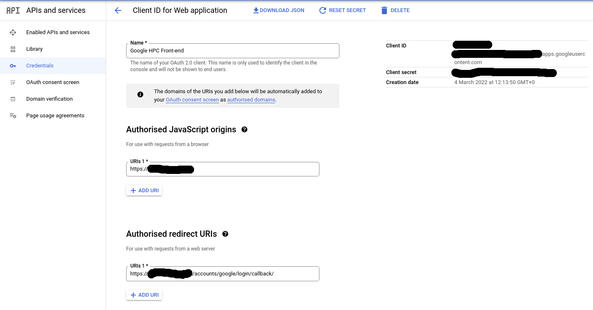
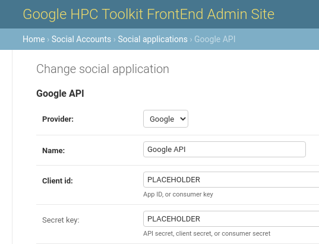

# Cluster Toolkit FrontEnd - Administrator’s Guide

<!--
0        1         2         3         4         5         6         7        8
1234567890123456789012345678901234567890123456789012345678901234567890234567890
-->

This document is for administrators of the Cluster Toolkit FrontEnd (TKFE). An
administrator can deploy the TKFE portal, manage the lifecycle of HPC clusters,
set up networking and storage resources that support clusters, install
applications. and manage user access. Normal HPC users should refer to the
[User Guide](user_guide.md) for guidance on how to prepare and run jobs on
clusters that have been set up by administrators.

Basic administrator knowledge of the Google Cloud Platform is needed in order to
create projects and user accounts, but all other low-level administration tasks
are handled by the portal.

TKFE is a web application built upon the Django framework.  By default, a
single Django superuser is created at deployment time - this superuser then has
administrator privileges in TKFE.  For large organisations that need additional
administrators, additional Django superusers can be created from the Admin site
within TKFE, once it is deployed and running.

The TFKE web application server uses the
[Cluster Toolkit](https://github.com/GoogleCloudPlatform/cluster-toolkit) to
provision resources for networks, filesystems and clusters, acting as a service
account that is registered to TKFE as a *credential*. By default this is the
provisioning service account that the deployment script creates. It has no key:
the server acts as it by impersonating it. The service account is used for
access management and billing.

This guide covers the deployment of TKFE, the service accounts it uses and how
credentials are registered, the steps required to then create and manage
clusters, and how to upgrade and tear down TKFE.  Further guides cover
installation of [Applications](Applications.md) and the
[Workbench](WorkbenchAdmin.md) Jupyter Notebook feature.
An [Advanced Administrators Guide](AdvancedAdmin.md) also covers features for
customising the TKFE deployment.

## TKFE Deployment

TKFE is deployed from a client machine using a script. The script will guide
the admin through the setup process, prompting for input of required
parameters, then deploy TKFE into the Google Cloud Platform.

TKFE can also be deployed using a configuration file specified with the --config option. In this case, the script will read the required parameters from the YAML file instead of prompting the user for input. This allows for more streamlined and automated deployment processes. However, it is important to ensure that all required parameters are properly specified in the configuration file before deploying.

### Prerequisites

#### Client Machine

The client machine must run Linux (or equivalent such as
[WSL](https://docs.microsoft.com/en-us/windows/wsl/install)) and there are a
small number of prerequisites that must be installed ahead of time:

- bash shell
- [Git](https://github.com/git-guides/install-git)
- [Terraform CLI](https://www.terraform.io/downloads) installation
- [Google Cloud CLI](https://cloud.google.com/cli) installation (`gcloud`,
  including the `gcloud storage` command)
  
#### Download TKFE

If not already downloaded, the TKFE repository needs to be cloned to the client
machine.

Clone the repository, checkout the corresponding branch, and switch to
the `front-end/ofe` directory as follows:

```bash
git clone https://github.com/GoogleCloudPlatform/cluster-toolkit.git
cd cluster-toolkit
cd community/front-end/ofe
```

All further deployment actions must be performed from this directory.

#### Google Cloud Platform

Your organisation must already have access to the Google Cloud Platform (GCP)
and be able to create projects and users.  A project and a user account with
enabled APIs and roles/permissions need to be created. The user account must
also be authenticated on the client machine to allow it to provision GCP
resources.

##### GCP project

A GCP project is required with the following APIs enabled:

```Text
 Cloud Monitoring API                       monitoring.googleapis.com
 Cloud Logging API                          logging.googleapis.com
 Compute Engine API                         compute.googleapis.com
 Cloud Pub/Sub API                          pubsub.googleapis.com
 Cloud Filestore API                        file.googleapis.com
 Cloud Resource Manager API                 cloudresourcemanager.googleapis.com
 Identity and Access Management (IAM) API   iam.googleapis.com
 IAM Service Account Credentials API        iamcredentials.googleapis.com
 Cloud OS Login API                         oslogin.googleapis.com
 Cloud Billing API                          cloudbilling.googleapis.com
 Vertex AI API                              aiplatform.googleapis.com
 BigQuery Connection API                    bigqueryconnection.googleapis.com
 Cloud SQL Admin API                        sqladmin.googleapis.com
 Service Networking API                     servicenetworking.googleapis.com
 Secret Manager API                         secretmanager.googleapis.com
 Service Usage API                          serviceusage.googleapis.com
 Cloud Storage API                          storage.googleapis.com
```

The IAM Service Account Credentials API is how the web server acts as the
keyless provisioning account.

If these are not enabled, the deployment script will ask to enable them for
you. It's not possible to complete a deployment without these APIs, so the
script will abort if not selected. With `--config` (see
[Automated deployment process](#automated-deployment-process)), the script
enables any that are missing without asking. Either way, if you do not have
permission to enable APIs on the project, the script stops and a project
administrator must enable them.

##### GCP user

A GCP user that is a member of the project will be able to deploy TKFE, but
must have appropriate privileges.  A user that is an *Owner* of the project
will automatically have all required roles and permissions.  Alternatively,
another account with access to the project, but a limited set of roles can be
used, which can help satisfy security concerns. The `gcloud` command can be
used to [switch to another account](https://cloud.google.com/sdk/gcloud/reference/auth/login)
and apply IAM roles.  IAM roles can also be applied via the GCP Console. The
required roles are:

```Text
 Compute Admin
 Storage Admin
 Pub/Sub Admin
 Service Account Admin
 Service Account User
 Project IAM Admin
 Role Administrator
 Secret Manager Admin
```

Service Account Admin creates the web server's and the provisioning service
accounts and lets the web server's account impersonate the provisioning one.
Role Administrator creates the web server's custom IAM role, and Secret Manager
Admin creates the secrets that hold the server's database encryption key and
its configuration, including the admin password (see
[Service Accounts and Permissions](#service-accounts-and-permissions)).

If required, an even stricter, or least-privilege custom role can be created -
please refer to the [Advanced Admin Guide](AdvancedAdmin.md#custom-rolespermissions-and-apis).

The user account must also be [authenticated to deploy GCP resources](https://cloud.google.com/sdk/gcloud/reference/auth/application-default/login).
This can be done with the following command:

```bash
gcloud auth application-default login --project=<PROJECT_ID>
```

You will be prompted to open your web browser to authenticate.

If further help is needed, please refer to GCP documentation for:

- [Creating and managing projects](https://cloud.google.com/resource-manager/docs/creating-managing-projects)
- [Enabling APIs](https://cloud.google.com/endpoints/docs/openapi/enable-api)
- [Granting and roles/permissions](https://cloud.google.com/iam/docs/creating-custom-roles)

### Deployment Process
#### Manual deployment process

TKFE uses a deployment script run on the client machine, prompting for required
parameters, to configure TKFE.

1. Run `./deploy.sh`
1. Follow prompts to name the FrontEnd VM instance, specify the GCP project,
   zone and subnet (subnet is optional, and one will be created if required).
   The hosting VM will be referred to as the *service machine* from now on.
   The name (the deployment name) may be at most 22 characters long, because
   service account names, which are limited to 30 characters, are made from
   it.
1. Follow prompts to enter domain name (DNS hostname) and IP address for the
   service machine.
   - For a production deployment, provide a domain name and static IP
     address.  If a static IP is needed, follow the on-screen instructions. An
     SSL certificate will automatically be obtained via
     [LetsEncrypt](https://letsencrypt.org/) to secure the web application.
   - For dev and testing purposes, the domain name and static IP address and
     domain name can be left blank. The system can still be successfully
     deployed and run with an ephemeral IP address, however OAuth2-based login
     (see later) will not be available as this requires a publicly resolvable
     domain name.
1. Follow instructions to provide details for an Admin (the Django superuser)
   account - username, password, email address.
1. The script creates the provisioning service account
   `<deployment_name>-prov-sa` in the project, with no key, and grants it the
   roles TKFE needs to create resources (see
   [Service Accounts and Permissions](#service-accounts-and-permissions)). An
   account that already exists with this name is reused and given the same
   roles. If that account has user-managed keys, whose holders would get
   those roles, the script warns, naming each key with the command that
   deletes it; if its keys cannot be listed, it warns that they were not
   checked and gives the command that lists them. In either case it then asks
   "Continue and grant the roles to this account?", and *N*, or no answer,
   stops it with nothing granted (with `--config` it cannot ask, and goes on
   after the warning). The server
   registers it as a credential by itself when it first starts, so nothing
   needs to be copied into TKFE.
   - The script then asks whether to write a key file for this account.
     Answer *No*: TKFE does not need a key. A key file (`credential.json`) is
     written in plain text, and anyone who holds it can act as the account,
     which can administer IAM in the project.
1. Confirm the parameters are correct when prompted and the deployment can
   proceed.
   - If confirmed, the VM instance will be created.  This can take a few
     minutes.
   - If you answer *N* at "Proceed to deploy?", nothing is deployed, but the
     provisioning account created above remains, with its project roles. The
     script names it and the command that deletes it,
     `script/service_account.sh delete <PROJECT_ID> <deployment_name>-prov-sa`.
     `./teardown.sh` also offers to delete it, or lists it with that command.
     Running `./deploy.sh` again reuses it.
   - **Note: after the deploy script has completed, it will still take up to
     another 15 minutes to fully install the TKFE server with its full
     software stack.**

#### Automated deployment process
TKFE can also be deployed automatically using a YAML configuration file with all the required parameters. To deploy using this option, run ./deploy.sh --config <path-to-config-file>. All required parameters for deployment must be specified in the YAML file. If any required parameter is missing or invalid, the script will exit with an error. If all parameters are provided correctly, the deployment process will proceed automatically without any prompts for user input.

If a required parameter is missing from the file, the script exits with an
error before it changes anything. An error later in the deployment also stops
the script, but by then it may have changed the project:

- It enables any of the required APIs that are missing, and then creates the
  provisioning account `<deployment_name>-prov-sa` (or gives an existing one
  its roles again), before Terraform runs. If `terraform init`, or reading
  the existing Terraform state, then fails, the script stops before the
  apply and says that Terraform has changed no resource and that the
  provisioning account has already been created.
- A Terraform apply that fails can leave some resources created or changed.

Once the cause is fixed, run the script again with the same file: it reuses
the provisioning account and applies the same configuration again. To remove
what a failed deployment created instead, use `teardown.sh` (see
[Teardown Process](#teardown-process)). This also works when the deployment
stopped before Terraform created anything: the script then has nothing to
destroy, but still offers to delete the provisioning account and its project
roles, or lists it with the command that deletes it (with `-y` it only lists
it).

If the DJANGO_SUPERUSER_PASSWORD environment variable is set, the script will use it to set the Django superuser password instead of the value in the YAML file. This is a more secure way of handling passwords.

A deployment with `--config` creates the same keyless provisioning service
account as an interactive one, and never writes a key file. As in an
interactive deployment, that account is granted access to the Terraform state
bucket. Add any other provisioning credential, including one from another
project, to `state_bucket_writers` in
`tf/state_bucket/deployments/<deployment_name>/admin.auto.tfvars`, then run
`terraform -chdir=tf/state_bucket/deployments/<deployment_name> apply`. See
[Terraform State](#terraform-state).

To use this configuration file for automated deployment, follow these steps:

1. Create a file called `config.yaml` (do not place inline `#` comments on value lines — `deploy.sh` parses values directly):

  ```yaml
  deployment_name: my-deployment
  project_id: my-project-id
  zone: us-west1-a
  # Optional fields: subnet_name, dns_hostname, ip_address, deployment_mode, repo_fork, repo_branch
  subnet_name: my-subnet
  dns_hostname: myhostname.com
  ip_address: 1.2.3.4
  django_superuser_username: sysadm
  # Optional if DJANGO_SUPERUSER_PASSWORD is set in the environment
  django_superuser_password: Passw0rd!
  django_superuser_email: sysadmin@example.com
  deployment_mode: git
  repo_fork: GoogleCloudPlatform
  repo_branch: develop
  ```

 1. Save the file in the same directory as the deploy.sh script.
 1. Open a terminal and navigate to the directory where the files are located.
 1. Run the following command: ./deploy.sh --config config.yaml
 1. The script will read the parameters from the config file and proceed with the deployment process. If DJANGO_SUPERUSER_PASSWORD environment variable is set, the script will use it to set the Django superuser password instead of the value in the YAML file.

<!--
TODO:  Give instruction for a custom deployment.

If a custom TKFE deployment is needed, the final step can be cancelled  Then
hack any files in ./tf and manually run `terraform apply` in the `frontend/tf` directory after properly setting the `terraform.tfvars`.
-->

**Important: To ensure that the TKFE resources can be fully cleaned up at a
later date, ensure that the directory containing the terraform configuration
(`./tf`) is retained.**

The deployment is now complete and after ~15 minutes, it will be possible to
log into the TKFE using the Admin account details given, at the specified
domain name or IP address via a web browser.  The IP address will be output as
`server_ip`.

---

## Post-deployment Configuration

### Credential Management

TKFE creates and manages cloud resources as the
[service account](https://cloud.google.com/iam/docs/service-accounts) of a
*credential*, chosen for each network, filesystem, cluster, image and
workbench. Credentials are registered by the Admin on the *Credentials* page.
A credential is one of two kinds:

- **Impersonated service account (no key)**, the default. TKFE stores only
  the service account's e-mail address and the project the credential
  provisions in. The server acts as the account by impersonating it with its
  own identity, so there is no key to store or leak.
  - When the server first starts, it registers a credential named
    *OFE provisioning account* for the provisioning account that the
    deployment script created, owned by the first admin user. A new TKFE is
    therefore ready to use without registering anything.
  - To add another, choose this kind, then enter the service account and the
    project ID. The web server's account
    (`<deployment_name>-fe-sa@<PROJECT_ID>.iam.gserviceaccount.com`) needs the
    *Service Account Token Creator* role on that service account; TKFE does
    not grant it. When the credential is saved, TKFE checks that the server
    can impersonate the account and that the account can see the project.
- **Uploaded service account key**. Paste the service account's JSON key.
  TKFE checks the key and reads its project from it.
  - The key is stored encrypted. The encryption key is held in the Secret
    Manager secret `<deployment_name>-db-key`, which the server creates on
    first start; it is not in the database, in Terraform state or on the
    server's disk.
  - When a tool runs with the key, Terraform receives it in memory. Tools
    that only read a key file (`gcloud`, Packer and the Cluster Toolkit's
    validation) get a copy readable only by the server's user (mode 0600) in
    a new private directory on the memory-backed `/dev/shm`, which is removed
    when the run ends, also after an error. Only where `/dev/shm` is missing
    is the system temporary directory used, which may be on disk, and the
    server logs a warning.
  - Anyone who holds a key can act as its account, so prefer impersonation
    wherever it works.

**Image builds need an uploaded key.** Images are built with Packer, through
the Cluster Toolkit's custom-image module, which cannot impersonate a service
account yet. The image form refuses an impersonated credential, with the
message "Credential *name* impersonates *account* and has no key, but image
builds need an uploaded service account key ..." under the credential field,
so nothing is created. (An image that reaches a build with such a credential
by another route is stopped before anything is created, its status becomes an
error and the message is in the server's log, `/opt/gcluster/run/django.log`.)
Register a key credential for image builds, ideally for an account used only
for that. That account needs the provisioning account's roles, including IAM
administration, so anyone who holds its key can change the project's IAM
policy: keep the key file safe, delete it once it is pasted into the
credential form, and delete the key with `gcloud iam service-accounts keys
delete` when it is no longer needed.

A credential's details page shows its kind, project and service account. The
key itself is never shown again. To rename a key credential, edit it and
leave the key empty: the stored key is kept. A key pasted there replaces the
stored one; for a credential in use, it must be for the same service account
and project.

Credentials can also be listed and read through the server's REST API at
`/api/credentials/` by users with the cluster admin role, as the
command-line client's `credential list` command does. The API also creates
a credential when the request comes from a superuser, as on the
*Credentials* page; any other user is refused (HTTP 403). A credential created this way goes through the same
checks as on the *Credentials* page, and its key is encrypted the same way.
The command-line client's `credential add` command does not currently
work: it fails before it sends a request. Add credentials on the
*Credentials* page. The API cannot change or delete a credential: use the
*Credentials* page, as a superuser.

#### Rotating the database encryption key

The server encrypts uploaded keys with the newest enabled version of the
`<deployment_name>-db-key` secret, and decrypts them with whichever enabled
version encrypted them. To replace the key, for example on a schedule or
after a suspected exposure:

1. Add a new version holding a new Fernet key. On the server, whose own
   account may add versions to this secret, generate the key with the
   server's Python environment:

   ```bash
   /opt/gcluster/django-env/bin/python3 -c 'from cryptography.fernet import Fernet; print(Fernet.generate_key().decode(), end="")' | \
     gcloud secrets versions add <deployment_name>-db-key --project=<PROJECT_ID> --data-file=-
   ```

   Elsewhere, run it as an account that may add versions to the secret (for
   example a project owner), with any Python that has the `cryptography`
   package.

1. Restart the server, so that it reads the new version: restart the server
   VM, or, on the server, run
   `sudo supervisorctl restart 'gcluster-uvicorn-background:*'`. From then on
   new keys are encrypted with the new version. Each time the server VM
   starts, its startup script also re-encrypts the stored keys, as the next
   step does; restarting the services alone does not.
1. On the server, as the `gcluster` user (`sudo su - gcluster`), with the
   Python environment activated
   (`source /opt/gcluster/django-env/bin/activate`), in
   `/opt/gcluster/cluster-toolkit/community/front-end/ofe/website`, run
   `python manage.py ofe_rotate_credentials`. It first reads the secret's
   enabled versions; if it cannot (the secret is missing, its latest version
   is disabled, or Secret Manager cannot be reached), it exits with a
   non-zero status and an error that starts `The database keys cannot be
   read`, and changes nothing: fix the secret or its access and run it
   again. It then re-encrypts every stored
   key with the newest version and prints how many keys it re-sealed, how
   many were already sealed with it, how many it encrypted from plaintext,
   how many "changed while this ran and left for the next run" and
   how many are "unreadable". It succeeds only when the last two are 0: it
   then prints `Every stored key is sealed with the newest database key`.
   Otherwise it exits with a non-zero status and an error that names the
   credential ids:
   - keys that changed while it ran: run the command again;
   - unreadable keys: no enabled version of the secret decrypts them. If you
     disabled a version, enable it again and run the command again;
     otherwise delete each of these credentials in TKFE and add it again.
1. Only once the command has succeeded, disable the old version, which
   leaves it recoverable:

   ```bash
   gcloud secrets versions list <deployment_name>-db-key --project=<PROJECT_ID>
   gcloud secrets versions disable <OLD_VERSION> --secret=<deployment_name>-db-key --project=<PROJECT_ID>
   ```

   Restart the server again so that it stops using the disabled version. If
   a credential then cannot be read, enable the old version again with
   `gcloud secrets versions enable`, restart the server and run step 3 again.
   Destroy the old version (`gcloud secrets versions destroy`) only once you
   are sure no stored key needs it, and not while a database backup taken
   before the rotation might still be restored: keys encrypted with a
   destroyed version cannot be recovered.

Credentials for other projects can be registered too: see
[Multi-project Configuration](AdvancedAdmin.md#multi-project-configuration).

#### Stored credentials at start

Each time the server starts, including its first boot, it prepares stored
credentials (`python manage.py ofe_bootstrap_credentials`): it gives the
`<deployment_name>-db-key` secret its first version if it has none,
encrypts stored keys with the newest database key, and registers the *OFE
provisioning account* credential. If any of this fails, the startup script
logs `ERROR: preparing stored credentials failed` to the server VM's serial
port output, the server still starts, and the pages of the web interface
show superusers a red banner, *Preparing stored credentials failed when the server last started*,
with the errors. The banner stays until a start succeeds. The usual causes:

- the database-key secret cannot be read or given a version: check that the
  secret exists and that the server's account still holds *Secret Manager
  Secret Accessor* and *Secret Version Adder* on it (see
  [Web server account](#web-server-account)), and that a version of it is
  enabled;
- the provisioning account cannot be registered: check that the instance
  metadata key `ofe-provisioning-service-account` names an existing account
  and that the server's account holds *Service Account Token Creator* on it;
- stored keys that cannot be read: the error names the credential ids. If a
  version of the database-key secret was disabled, enable it again;
  otherwise delete each of these credentials and add it again.

An unexpected error is shown by its type only, such as *Database key or
stored keys: unexpected error (OperationalError)*; its details are in the
server log, `/opt/gcluster/run/django.log`, and in the serial port output.

Fix the cause, then restart the server VM, or run the command as the
`gcluster` user, with the Python environment activated, in
`/opt/gcluster/cluster-toolkit/community/front-end/ofe/website`. The banner
goes once the command succeeds.

## Service Accounts and Permissions

TKFE uses separate service accounts for the web server, for provisioning
resources, and for each cluster and image build. None of the accounts that
TKFE or its deployment script create has a key.

### Web server account

The service machine runs as `<deployment_name>-fe-sa`. Its permissions are
granted, where possible, on the individual resources it uses rather than on
the project:

- *Logs Writer*, *Monitoring Metric Writer* and *Monitoring Viewer* on the
  project. Monitoring Viewer lets Grafana read cluster metrics without a key.
- *Storage Admin* on the TKFE control bucket only, *Pub/Sub Admin* on the
  command-and-control topic only, and *Pub/Sub Subscriber* on the server's
  own two subscriptions.
- A custom role on the project to create, read and delete the Pub/Sub
  subscription that each cluster gets, and to set its IAM policy. These
  subscriptions are created at run time, so they cannot be granted in
  advance. The same role holds `compute.machineTypes.get`: the Cluster
  Toolkit's `gcluster create` looks up each machine type in a blueprint as
  the server's own account, not as the provisioning account it impersonates.
  It reads public machine-type specifications only.
- *Secret Manager Secret Accessor* and *Secret Version Adder* on the
  `<deployment_name>-db-key` secret only, for the database encryption key.
- *Secret Manager Secret Accessor* on the `<deployment_name>-server-config`
  secret only. It holds the server's configuration, which the startup script
  reads on first boot: the admin user's name, password and e-mail address,
  the git fork and branch to install and the other first-boot settings. TKFE
  grants read access to it only to the web server's account, so, unlike an
  object in the control bucket, it cannot be read by the accounts of
  clusters created with this version. Principals that hold Secret Manager
  roles on the whole project can still read it while a version is enabled
  (see the next item), and an administrator among them can enable a version
  again: project owners, the
  provisioning account, and the shared service account of any cluster
  created before an upgrade to this version, which holds Secret Manager
  Secret Accessor (and Project IAM Admin) on the whole project until the
  cluster is recreated. Recreate such clusters to remove that access.
- *Secret Manager Secret Version Manager* on the
  `<deployment_name>-server-config` secret only. Once the first boot has
  installed and started the server, the startup script disables the version
  it read. While a
  version is disabled no one can read it: principals with Secret Manager
  access on the whole project (such as the shared account of a cluster
  created before an upgrade) can no longer read the admin password. The
  server's own account holds both roles on this secret, so it could enable
  the version again and read it; anyone who takes control of the server VM
  could too, which is part of the risk of a compromised server described
  under [Provisioning account](#provisioning-account). The version stays
  enabled, readable by those principals, for the whole first boot (often
  tens of minutes), and longer if the first boot does not finish:
  - a first boot whose fetch of the TKFE code fails, or is interrupted (the
    VM is stopped or reset during it), installs nothing and leaves the
    version enabled; restarting the VM tries again with no other step (a
    partial copy of the code is removed first);
  - a first boot that fails or stops after the fetch (in the Django set-up,
    for example, or before the server and the TKFE application are running)
    leaves a partly installed server. The startup script writes a
    completion marker only once the install has succeeded and both are
    running. Otherwise it stops and disables the web server, so the site is
    not served half-installed, and that boot, if it gets that far, and every
    later boot log `ERROR: the first boot did not finish installing TKFE ...`
    and leave the version enabled. Recreate the server VM (see below; the
    version is still enabled, so there is nothing to enable first). Servers
    installed by an earlier TKFE version have no markers and start as
    before.

  If the startup script
  cannot disable the version, it logs `ERROR: could not disable version ...`
  to the server VM's serial port output, with the command that disables it,
  and the server disables it the next time it starts. An installed
  server also disables every version of the secret that is still enabled
  each time it starts, and logs a warning if it cannot. This role lists,
  enables and disables versions; it cannot read them. Terraform does not
  enable a disabled version again, but a change to the configuration (for
  example a new admin password given to the deployment script) creates a new,
  enabled version, which the server disables when it next starts.

**A new server VM needs the configuration version enabled again.** A server
VM that is created again (for example after it was deleted) runs its first
boot again and must read the configuration, but its version is disabled
(unless the old VM never finished its first boot: then it is still enabled,
which the list command below shows). Before you
create or restart it, enable the version again:

```bash
gcloud secrets versions list <deployment_name>-server-config --project=<PROJECT_ID>
gcloud secrets versions enable <VERSION> --secret=<deployment_name>-server-config --project=<PROJECT_ID>
```

Alternatively, run the deployment script with new values, for example a new
admin password, which stores a new, enabled version. The new server disables
the version again once its first boot has installed it. If you skip this, the first boot stops
with `ERROR: could not read the server configuration from secret ...` in the
serial port output, followed by the `gcloud secrets versions enable` command
for the version it tried.
- *Service Account Token Creator* on the provisioning account only, which is
  how the server impersonates it.

The VM uses the `cloud-platform` access scope; what it can do is limited by
these grants, not by scopes. [tf/README.md](../tf/README.md) lists each grant
and why it is needed.

### Provisioning account

The deployment script creates `<deployment_name>-prov-sa` with
`script/service_account.sh create`, with no key. The server creates networks,
filesystems, clusters, images and workbenches as this account, through the
*OFE provisioning account* credential. The account's project roles, and what
each is for, are listed in the
[Advanced Admin Guide](AdvancedAdmin.md#the-provisioning-account-and-its-roles).

Among them are IAM administration roles (*Project IAM Admin*,
*Service Account Admin*, *Service Account User* and *Role Administrator*),
granted on the whole project without IAM conditions. Every new cluster and
image build creates its own service accounts, custom roles and grants, and
Google IAM conditions cannot limit creating service accounts or roles,
acting as service accounts, or granting custom roles to the ones TKFE
creates. This has consequences:

- Whoever controls the TKFE server, an administrator or anyone who takes
  control of the service machine, controls this account, and through it IAM
  in the project. The web server can impersonate the account, which can grant
  any role in the project, including *Owner*, so a compromise of the web
  server can reach project-owner level.
- TKFE grants only the web server's account permission to impersonate it,
  and it has no key that could be copied. Every change it makes is recorded in the project's
  [Cloud Audit Logs](https://cloud.google.com/logging/docs/audit) (Admin
  Activity logs, which are always on), naming the account.
- **Run TKFE in a Google Cloud project of its own**, holding nothing that
  TKFE does not manage, so that this account cannot reach anything else.
- **Consider an organization policy that refuses grants of the Owner and
  Editor roles** in the TKFE project. TKFE never grants these roles, but
  whoever controls this account could. The policy narrows the risk but does
  not remove it: the account can still create a custom role with the same
  permissions and grant that. An Organization Policy Administrator sets the
  policy outside TKFE; see
  [Hardening the provisioning account with an organization policy](AdvancedAdmin.md#hardening-the-provisioning-account-with-an-organization-policy).

### Cluster accounts

Each new cluster gets its own service accounts, created by the Cluster
Toolkit `modules/project/service-account` module with no project roles. Each
account is then given only what its nodes need by the
`community/modules/iam/service-account-profiles` module, whose profiles are
documented in its README. The accounts are named after the cluster's cloud
ID, `<cluster name>-<8 hexadecimal characters>`:

- `<cloud ID>-ctl`, the Slurm controller (profile `slurm-controller`): logs
  and metrics; a custom role with the Compute Engine permissions Slurm needs
  to create, poll, suspend and delete nodes; permission to change instance
  metadata only on VMs whose names start with the cluster's Slurm cluster
  name (that is, this cluster's nodes); *Service Account User* only
  on this cluster's own compute accounts; *Storage Object Viewer* on the TKFE
  control bucket, limited to the cluster's own files (see below), and
  *Storage Object User* only on its objects under `clusters/<cluster ID>/`; *Pub/Sub Subscriber* on the cluster's command subscription
  and *Pub/Sub Publisher* on the command-and-control topic; and, when the
  cluster uses them, placement policies, BigQuery job accounting and read
  access to the cluster's container registries.
- `<cloud ID>-lgn`, the login nodes (profile `slurm-login`): logs and
  metrics, and *Storage Object Viewer* on the control bucket, limited to the
  cluster's own files.
- `<cloud ID>-cmp`, the compute nodes of every partition (profile
  `slurm-compute`): logs and metrics, and *Storage Object Viewer* on the
  control bucket, limited to the cluster's own files.
- `<cloud ID>-c00` to `<cloud ID>-c99`, optional: a partition with
  *Separate service account* set runs as an account of its own, with the same
  permissions as `<cloud ID>-cmp`. This choice cannot be changed once the
  cluster has been created; add a new partition instead.

In a cluster created by this release, login and compute nodes can only read
the control bucket: their bootstrap
script and the shared setup files under `clusters/ansible_setup/`. Only the
controller writes there, and only under `clusters/<cluster ID>/` (logs, job
output and application install logs): its *Storage Object User* grant
carries an IAM condition,
`resource.name.startsWith("projects/_/buckets/<control bucket>/objects/clusters/<cluster ID>/")`,
titled `ofe-cluster-<cluster ID>-prefix`. Neither a user's job nor anyone
who controls a controller VM can change the TKFE server's startup script,
which runs as root each time the TKFE server boots, or another cluster's
files. Clusters created before the upgrade to this release do not have this
limit: their nodes can write anywhere in the bucket until they are
recreated (see [After upgrading](#after-upgrading)). IAM conditions need
uniform bucket-level access, which TKFE turns on
when it creates the control bucket; do not turn it off.

Reading is limited too. Every node of such a cluster reads the control bucket
only through a *Storage Object Viewer* grant with an IAM condition, titled
`ofe-cluster-<cluster ID>-node-files`: it can list the bucket, and read
the shared setup files under `clusters/ansible_setup/` and its own cluster's
`clusters/<cluster ID>/bootstrap_*` files, nothing else. Other clusters'
files and the server's own files, such as `webserver/startup.sh` and the
TKFE code, cannot be read from a cluster node. Clusters that use the shared
account of the earlier identity model (created before the upgrade to this
release) are unchanged: their nodes can read the whole bucket until they are
recreated. TKFE puts no credentials or keys in the bucket (the code package
leaves out the files git ignores).

Every account also gets read access to the cluster's Slurm files bucket,
`slurm-<cloud ID>-<8 hexadecimal characters>`, which TKFE creates with the
Cluster Toolkit `modules/file-system/cloud-storage-bucket` module and deletes
with the cluster. TKFE creates it, rather than leaving it to the Slurm
controller module, so that this access is in place before any of the
cluster's VMs starts; otherwise a controller could start before it can read
the bucket, and stay *being initialised*. A cluster with existing service
accounts (see
[Using existing service accounts](#using-existing-service-accounts)) keeps
the bucket the Slurm controller module creates.

What else a new cluster's nodes can reach with these accounts:

- **File systems** (the cluster's built-in home directory, Filestore, and
  imported NFS, Lustre, DAOS or BeeGFS file systems) are mounted over the
  network, not through the accounts, so they are read and written as before.
- **The cluster's container registries**: the controller can read them and
  passes a short-lived token to container jobs, so those jobs can use their
  images. Images in other registries need *Artifact Registry Reader* on that
  repository for the controller account.
- **The Slurm accounting database** (*Use Cloud SQL*): the Slurm controller
  module creates the database password secret and lets the controller read
  it.
- **Other Cloud Storage buckets**: a job's script, input-dataset or
  result-dataset `gs://` URL is copied by the compute nodes. The compute
  accounts have no access to the project's other buckets, so either the user
  registers their own Google login in TKFE, or an administrator grants the
  cluster's compute account *Storage Object Viewer* (read) or *Storage Object
  User* (read and write) on that bucket.

Clusters created before this version keep their shared account and its
project-wide access.

The custom roles get new IDs each time a cluster is started after being
destroyed, because Google keeps the ID of a deleted role for up to 44 days.

Clusters created before this version run all their nodes as one shared
account with broad project roles, including IAM administration roles. They
keep it until they are destroyed and created again (see
[Upgrading an existing TKFE](#upgrading-an-existing-tkfe)).

Removing IAM administration from the cluster accounts does not change how
users log in to clusters or use `sudo`. Those come from each user's own
OS Login roles (for example *Compute OS Login* or
*Compute OS Admin Login*), not from the nodes' service accounts.

### Image builder account

Each new image build gets its own account, `img-<image ID>-bld`, for the
temporary Packer build VM (profile `image-builder`): logs and metrics;
`compute.instances.get` and *Service Account User* on itself, which the build
VM needs to signal that it has finished;
permission to change instance metadata only on VMs named `packer-*`; and read
access to the bucket that holds the build's startup scripts. It is created
with the build environment and removed when that environment is destroyed
after the build. Images built before this version used the project's default
Compute Engine service account.

## Network Management

All cloud systems begin with defining the network that components will
exist in. Before a cluster or stand-alone filesystem can be created, the
administrator must create the virtual private cloud (VPC) network. This is
accomplished under the *Networks* main menu item. Note that network resources
have their own life cycles and are managed independently.

### Create a new VPC
To create a new network, the admin must first select which credential should be
used for this network, then give the VPC a name, and then select the cloud
region for the network.

Upon clicking the *Save* button, the network is not immediately created. The
admin has to click *Edit Subnet* to create at least one subnet in the VPC.
Once the network and subnet(s) are defined, click the ‘Apply Cloud Changes’
button to trigger creation of the VPC and subnet(s).

<!-- Behind the scenes, gcluster is used to get Terraform to provision the cloud resources. -->

### Import an existing VPC

If your organisation already has predefined VPCs within the hosting GCP
project, they can be imported.  Simply select an existing VPC and associated
subnets from the web interface to register them with TKFE.  Imported VPCs
can be used in exactly the same way as newly created ones.

## Filesystem Management

By default each cluster creates two shared filesystems: one at `/opt/cluster` to
hold installed applications and one at `/home` to hold job files for individual
users. Both can be customised if required. Optionally, additional filesystems
may be created and mounted to the clusters. Note that filesystem resources have
their own life cycles and are managed independently, so they persist until
explicitly deleted and can be attached to several clusters in the same subnet.

### Create new filesystems

Currently, only GCP Filestore is supported. GCP Filestore can be created from
the *Filesystems* main menu item. A new Filestore has to be associated with an
existing VPC and placed in a cloud zone. All performance tiers are supported.

Click *Start Filestore* on the filesystem's page to create it. The page shows
the filesystem's Terraform log, which only signed-in users can read. If the
create fails or is refused (see [Permission checks](#permission-checks)), the
filesystem goes back to its unstarted state: fix the cause and click
*Start Filestore* again. The retry replaces the Cluster Toolkit deployment
folder that the earlier attempt left on the server.

### Import existing filesystems

Existing filesystems can be registered to this system and subsequently mounted
by clusters. These can be existing NFS servers (like Filestore), or other
filesystems for which Linux has built-in mount support. For this to work, for
each NFS server, provide an IP address and an export name. The IP address must
be reachable by the VPC subnets intended to be used for clusters.

An internal address can be used if the cluster shares the same VPC with the
imported filesystem. Alternatively, system administrators can set up hybrid
connectivity (such as extablishing network peering) before mounting the
external filesystem located elsewhere on GCP.

## Cluster Management

HPC clusters can be created after setting up the hosting VPC and any
additional filesystems. The Cluster Toolkit FrontEnd can manage the whole life
cycles of clusters. Click the *Clusters* item in the main menu to list all
existing clusters.

### Cluster Status
Clusters can be in different states and their *Actions* menus adapt to this
information to show different actions:

- `n` – Cluster is being newly configured by user. At this stage, a new
  cluster is being set up by an administrator. Only a database record exists,
  and no cloud resource has been created yet. User is free to edit this cluster:
  rename it, re-configure its associated network and storage components, and add
  authorized users. Click *Start* from the cluster detail page to actually
  provision the cluster on GCP.
- `c` – Cluster is being created. This is a state when the backend
  Terraform scripts is being invoked to commission the cloud resources for the
  Cluster. This transient stage typically lasts for a few minutes.
- `i` – Cluster is being initialised. This is a state when the cluster
  hardware is already online, and Ansible playbooks are being executed to
  install and configure the software environment of the Slurm controller and
  login nodes. This transient stage can last for up to 15 minutes.
- `r` – Cluster is ready for jobs. The cluster is now ready to use.
  Applications can be installed and jobs can run on it. A Slurm job scheduler is
  running on the controller node to orchestrate job activities.
- `t` – Cluster is terminating. This is a transient state after Terraform
  is being invoked to destroy the cluster. This stage can take a few minutes
  when Terraform is working with the cloud platform to decommission cloud
  resources.
- `d` – Cluster has been destroyed. When destroyed, a cluster cannot be
  brought back online. Only the relevant database record remains for information
  archival purposes.

A visual indication is shown on the website for the cluster being in creating,
initialising or destroying states. Also, relevant web pages will refresh every
15 seconds to pick status changes.

### Create a new cluster

A typical workflow for creating a new cluster is as follows:

1. At the bottom of the cluster list page, click the *Add cluster* button to
   start creating a new cluster. In the next form, choose a cloud credential.
   This is the Google Service Account which will create the cloud resources;
   normally *OFE provisioning account*.
   Click the *Next* button to go to a second form from which details of the
   cluster can be specified.
1. In the *Create a new cluster* form, give the new cluster a name. Cloud
   resource names are subject to naming constraints and will be validated by the
   system.  In general, lower-case alphanumeric names with hyphens are
   accepted.
1. From the *Subnet* dropdown list, select the subnet within which the cluster
   resides.
1. From the *Cloud zone* dropdown list, select a zone.
1. From the *Authorised users* list, select users that are allowed to use this
   cluster.
1. Click the *Save* button to store the cluster settings in the database.
   Continue from the *Cluster Detail* page.
1. Click the *Edit* button to make additional changes. such as creating more
   Slurm partitions for different compute node instance types, or mounting
   additional filesystems.
   - For filesystems, note the two existing shared filesystems defined by
     default. Additional ones can be mounted if they have been created earlier.
     Note the *Mounting order* parameter only matters if the *Mount path*
     parameter has dependencies.
   - For cluster partitions, note that one *c2-standard-60* partition is
     defined by default. Additional partitions can be added, supporting
     different instance types. Enable or disable hyperthreading and node reuse
     as appropriate. Also, placement group can be enabled (for C2 and C2D
     partitions only). In the *image* field one can optionally supply a custom
     image to be used by the compute nodes. Administrators should ensure such
     an image is compatible to the CentOS 7 based machine image used by Slurm
     GCP. Otherwise additional customisation done by this system might fail.
     Set *Separate service account* to run a partition's nodes as an account
     of their own instead of the cluster's shared compute account (see
     [Cluster accounts](#cluster-accounts)).
   - Optionally, enter existing service accounts for the cluster's nodes
     (see [Using existing service accounts](#using-existing-service-accounts)).
1. Finally, save the configurations and click the *Create* button to trigger
   the cluster creation. TKFE first checks that the credential's service
   account has the permissions the cluster needs (see
   [Permission checks](#permission-checks)).

Node host names of a new cluster start with its Slurm cluster name, which TKFE
makes unique per cluster: the first 11 letters and digits of the cluster name
followed by the 8 hexadecimal characters at the end of its cloud ID (for
example `mycluster1a2b3c4d-...` for a cluster named `my-cluster`). Clusters
created before this version keep their earlier names, which start with the
first 10 letters and digits of the cloud ID. The controller's permission to
change instance metadata covers only VMs whose names start with this prefix,
so one cluster's controller cannot change the metadata of another cluster's
VMs or of the TKFE server.

### Using existing service accounts

The cluster form has an optional *Existing service accounts* section, for an
administrator who manages the cluster's service accounts outside TKFE. Enter
all three accounts (controller, login and compute) or none; they can only be
set before the cluster is created. With them, TKFE creates no service account
and makes no IAM grant for the cluster: its nodes run as the accounts given,
every partition runs as the compute account, and *Separate service account*
on a partition is ignored. Only user-created service accounts are accepted,
not the default Compute Engine or App Engine accounts, nor Google-managed
service agents, nor the accounts TKFE creates: any TKFE server's
(`<deployment_name>-prov-sa`, `-fe-sa`, and `-tkfe-sa` from an earlier
version, for this or another deployment), workbenches'
(`sa-p-notebook-<hexadecimal characters>`), image builders' (`img-<ID>-bld`),
and clusters' (`<cloud ID>-ctl`, `-lgn`, `-cmp`, `-c00` to `-c99`, and
`<cloud ID>-sa` of a cluster created before this version). Several of these
can change the project's IAM policy or take over the project's VMs.

Only a superuser can set or change these accounts. Other users see the
fields read-only, and the form refuses a changed value with the message
"Only a superuser can set or change the existing service accounts." **Never choose a privileged account.** Any process
on a node can act as the account the node runs as, so the roles of the
accounts you give are available to every job and every user of the cluster.
Give them only the permissions listed below. TKFE's list of refused accounts
above is its only check: the provisioning account holds *Service Account
User* on the whole project, so Google Cloud lets it run a cluster as any
service account in the project.

Give the accounts these permissions yourself. Most can be given before the
cluster is created; two can only be given once it has started (see below):

- **Controller**: the permissions of the `slurm-controller` profile of the
  `community/modules/iam/service-account-profiles` module (see its README);
  *Service Account User* on the compute account; *Storage Object Viewer* on
  the TKFE control bucket with the read condition below, and *Storage Object
  User* on it with the IAM condition
  `resource.name.startsWith("projects/_/buckets/<control bucket>/objects/clusters/<cluster ID>/")`
  (the cluster ID is the number in the cluster page's address,
  `/cluster/<cluster ID>`, once the cluster form is saved); *Pub/Sub Publisher* on the TKFE
  command-and-control topic (named after the deployment). After the cluster
  has started, also:
  - the profile's name-scoped permission (`compute.instances.setMetadata`)
    on the cluster's nodes only, with an IAM condition on the instance-name
    prefix `<slurm cluster name>-`, as the module's name-scoped role does.
    The Slurm cluster name is shown nowhere in the UI; read it from the
    controller VM's name, `<slurm cluster name>-controller`, once that VM
    exists. Save the cluster form only once: while a cluster is new, each
    save gives it a new name;
  - *Pub/Sub Subscriber* on the cluster's command subscription,
    `<deployment_name>-cluster_<cluster ID>` in the TKFE project, which TKFE
    creates when the cluster starts. The cluster stays in *Creating* until
    this grant exists.
- **Login** and **Compute**: *Logs Writer* and *Monitoring Metric Writer* on
  the project, and *Storage Object Viewer* on the TKFE control bucket with
  the read condition below.

The read condition limits *Storage Object Viewer* to what a node reads: the
bucket listing, the shared setup files and this cluster's bootstrap scripts.
It is the condition TKFE gives the accounts it creates (titled
`ofe-cluster-<cluster ID>-node-files`):

`resource.name == "projects/_/buckets/<control bucket>" || resource.name == "projects/_/buckets/<control bucket>/objects/clusters/ansible_setup" || resource.name.startsWith("projects/_/buckets/<control bucket>/objects/clusters/ansible_setup/") || resource.name.startsWith("projects/_/buckets/<control bucket>/objects/clusters/<cluster ID>/bootstrap_")`

Without it the account can read every cluster's files in the bucket and the
server's own, such as `webserver/startup.sh`.

The form shows the same list under each field. The credential's service
account also needs *Service Account User* on all three accounts to create VMs
that run as them; the provisioning account has this role on every service
account in its own project.

### Clusters in another project

A cluster whose credential provisions in a project other than the TKFE
project needs extra permissions in the TKFE project, and so does Grafana for
its dashboards. See
[Clusters in another project](AdvancedAdmin.md#clusters-in-another-project).

### Features not available for new clusters

The cluster accounts' profiles do not cover these Slurm features, and TKFE
never enables them:

- the Slurm repair flow (`compute.instances.update`);
- opportunistic maintenance of compute nodes
  (`compute.instances.performMaintenance`);
- `controller_network_attachment`.

### Deleting a cluster

To destroy a cluster, first find the list of clusters in the *Clusters* menu,
then simply select *Destroy* pop-down *Actions* menu and confirm.
Any jobs still running on the Cluster will be automatically killed.

Before the destroy starts, TKFE checks that the credential's service account
can delete the cluster, including, when TKFE created the cluster's service
accounts, those accounts, their custom roles and IAM grants (see
[Permission checks](#permission-checks)). If it cannot, nothing is destroyed
and the cluster keeps its status.

Google Cloud occasionally fails to delete a cluster's custom IAM roles after
everything else has been destroyed. When only the roles are left (and, for a
cluster with TKFE-created accounts, its Slurm files bucket, which Terraform
keeps while the roles exist, as it keeps the cluster's container registry
repositories and their password secrets), the teardown completes, and a line
starting `OFE:` at the end of the cluster's Terraform log (on its *View Logs*
page, under *Terraform Log*) names what was left, with the command to delete
each item, for example:

```bash
gcloud iam roles delete <ROLE_ID> --project=<PROJECT_ID>
gcloud storage rm --recursive gs://<SLURM_FILES_BUCKET>
gcloud artifacts repositories delete <REPOSITORY_ID> --location=<REGION> --project=<PROJECT_ID> --quiet
gcloud secrets delete <SECRET_ID> --project=<PROJECT_ID> --quiet
```

The roles no longer have any members, the bucket holds only the cluster's
Slurm configuration, and a repository only the cluster's container images.
Run the commands as an account with permission to delete these in that
project. TKFE does not run the destroy again by itself.

After the destroy, TKFE also deletes any compute nodes that Slurm left
running: Slurm creates them directly, so they are not in the cluster's
Terraform state. If this clean-up fails, the server log
(`/opt/gcluster/run/django.log`) shows an `ERROR` line starting
`Orphaned compute node sweep failed for cluster`, which names the cluster,
its project and the cluster's `slurm_cluster_name` label. TKFE does not try
again, and the leftover nodes may still be running and billed. Find them and
delete them by hand:

```bash
gcloud compute instances list --filter="labels.slurm_cluster_name=<SLURM_CLUSTER_NAME>" \
  --project=<PROJECT_ID> --format="value(name,zone)"
gcloud compute instances delete <NAME> --zone=<ZONE> --project=<PROJECT_ID>
```

## User Management

### SSH access to the service machine

SSH access to the service machine is possible for administration purposes.
Administrators can choose from one of the following options:

- [SSH directly from the GCP console](https://cloud.google.com/compute/docs/instances/connecting-to-instance).
- [Add their public SSH key to the VM instance after deployment via GCP console](https://cloud.google.com/compute/docs/connect/add-ssh-keys#add_ssh_keys_to_instance_metadata).
- [Add their SSH key to the GCP project to use on all VMs within the project](https://cloud.google.com/compute/docs/connect/add-ssh-keys#add_ssh_keys_to_project_metadata).

*N.B The service machine is not, by default, configured to use the os-login service.*

### Set up Google OAuth2 login

While it is possible to use a Django user account to access the FrontEnd
website, and indeed doing so is required for some administration tasks, standard
users must authenticate using their Google identities via Google OAuth2.  This,
combined with the use of Google OSLogin for access to clusters, ensures
consistent Linux identities across VM instances that form the clusters. Web
frontend login is made possible by the *django-allauth* social login extension.

For a working  deployment, a fully-qualified domain name must be obtained and
attached to the website as configured in the deployment script.  Next, register
the site with the hosting GCP project on the GCP console in the *Credentials*
section under *APIs and services* category. Note that the *Authorised JavaScript
origins* field should contain a callback URL in the following format:
`https://<domain_name>/accounts/google/login/callback/`



From the GCP console, note the client ID and client secret. Then return to admin
site of the deployment, locate the *social applications* database table. A
'Google API' record should have been created during the deployment. Replace the
two placeholders with the client ID and client secret. The site is ready to
accept Google login.



#### Set Allowed Users by Email Address

Next, go to the *Authorised user* table. This is where further access control
to the site is applied. Create new entries to grant access to users. A new
entry can be:

- a valid domain name to grant access to multiple users from authorised
organisations (e.g. *@example.com*)
- an email address to grant access to an individual user (e.g
*user.name@example.com*)

All login attempts that do not match these patterns will be rejected.

#### Note on external users

If you wish to allow users from outside your Google Cloud organization to use
the cluster you will need to additionally assign these users the
`roles/compute.osLoginExternalUser` role at an Organization level (there is no
way to assign at the project level).

User accounts will be automatically created for users when they log into the
FrontEnd for the first time, by default new accounts are created with quota
disabled.  To enable job submission for an account, administrators must enable
compute quota from the *Users* page.

### User Compute Quota

Currently three quota modes are supported:

- **Unlimited quota** - User may submit an unlimited number of jobs
- **Limited quota** - User may submit jobs up to a total spend limit in USD
- **Quota Disabled** - User may not submit jobs - this is the default for newly created accounts

When **limited quota** is selected, an additional field **quota amount** will be available to set the total spend available to the user.

## Application Management

Please see the [application installation guide](Applications.md).

## Workbench Management

Please see the [Workbench Admin Guide](WorkbenchAdmin.md).

## Upgrading an existing TKFE

An upgrade cannot be undone: once these steps have run, the earlier version
can no longer run the deployment. Read
[Rolling back an upgrade](#rolling-back-an-upgrade) before you start.

The upgrade gives the deployment a keyless provisioning account with IAM
administration roles (see [Provisioning account](#provisioning-account)).
Consider asking an Organization Policy Administrator to refuse grants of the
Owner and Editor roles in the TKFE project, as described in
[Hardening the provisioning account with an organization policy](AdvancedAdmin.md#hardening-the-provisioning-account-with-an-organization-policy).

To move a running TKFE to a newer version:

1. Back up the database before changing anything. It is the SQLite file
   `/opt/gcluster/cluster-toolkit/community/front-end/ofe/website/db.sqlite3`
   on the server; for example, from the client:

   ```bash
   gcloud compute ssh <deployment_name>-server --zone <ZONE> --project <PROJECT_ID> \
     --command 'sudo sqlite3 -readonly /opt/gcluster/cluster-toolkit/community/front-end/ofe/website/db.sqlite3 .dump' \
     > tkfe-db-backup.sql
   ```

   (`sqlite3` may be at `/usr/local/bin/sqlite3`, where the startup script
   installs it.) Keep the file private: the database holds user accounts and
   any stored keys.
1. On the client machine, re-run the deployment script with the new version.
   This is needed when upgrading from a version that used a service account
   key as its credential (one whose deployment script offered to create a
   `<deployment_name>-tkfe-sa` account and a `credential.json` file).
   - Update the copy of the repository that TKFE was deployed from, in the
     same directory. Keep its `tf` directory, whose `terraform.tfstate`,
     `terraform.tfvars` and `.tkfe.lock` files hold the deployment.
   - If a key file `credential.json` written by an earlier version is still
     in that directory, delete it (its key is already registered in TKFE).
     This version no longer packs it: a deployment that uses a copy of the
     code from the client machine packs only the files git would commit, so
     git-ignored files such as `credential.json` and `website/.secret_key`
     stay on the client. Earlier versions packed the whole directory into the
     control bucket (see the note at the end of these steps).
   - The client needs Terraform 1.12.2 or later. The script runs
     `terraform init -upgrade`, which moves the lock file to the newer
     providers. If you use a provider mirror, it must first hold
     `hashicorp/google` and `hashicorp/google-beta` 7.33.0 or later (below
     8.0.0), `hashicorp/time`, `hashicorp/random` and `hashicorp/null`.
   - Run the script with `--config` (see
     [Automated deployment process](#automated-deployment-process)): the
     interactive mode stops when it finds the lock file of a deployed TKFE.
     Give the deployment's existing values, which are in
     `tf/terraform.tfvars`: `deployment_name`, `project_id`, `zone`,
     `subnet_name` (`subnet`), `dns_hostname` (`webserver_hostname`),
     `ip_address` (`static_ip`), `deployment_mode` and, for a git
     deployment, `repo_fork` and `repo_branch`. The admin user name, e-mail
     address and password are required too, but an installed server does
     not use them: the server creates the admin user only on its first boot,
     and an upgrade leaves the existing admin account and its password
     unchanged. The apply still stores the values you give in the
     server-config secret (see the last item of this step), so give a
     placeholder password, not the admin user's real one. If you have
     already given the real password, change it once the upgrade is done:
     sign in as the admin user, open the Django administration site
     (`/admin/`, *Admin* in the user menu) and use its *Change password*
     link, or, on the server, run
     `python manage.py changepassword <admin user name>` as the `gcluster`
     user in the Python environment and `website` directory used in the
     later steps.
   - The `deployment_key` variable has been removed. Remove any
     `-var deployment_key=...` argument of your own, or Terraform stops with
     an error that the variable is not declared; remove it from any
     `terraform.tfvars` file too, where Terraform only warns about it.
   - The deployment name must be at most 22 characters long, because the
     provisioning account `<deployment_name>-prov-sa` is named after it and
     service account names are limited to 30 characters. Earlier versions
     could deploy names of up to 24 characters. With a longer name, the script
     stops at once with the message that the deployment name is invalid and
     must be 3 to 22 characters long, before it enables any API or creates or
     changes any account, file or other resource. Such
     a deployment cannot be upgraded in place: keep it on its current
     version, or deploy a new TKFE with a shorter name, create its clusters
     and other resources there, and then remove the old deployment (see
     [Teardown Process](#teardown-process)).
   - The script checks the project's APIs against the list under
     [GCP project](#gcp-project) and enables any that are missing without
     asking, such as the Secret Manager and IAM Service Account Credentials
     APIs that this version needs. If it cannot enable one, it stops before
     it creates or changes any account or resource.
   - The script keeps the server's service account and the control bucket.
     The bucket keeps its existing location, even where that is not the
     deployment's region (servers deployed with `--config` by earlier
     versions have their bucket in the `US` multi-region). It forgets the
     account's old project roles and the bucket's old IAM
     bindings without deleting them, so the server and existing clusters
     keep their access throughout. It then grants the account the permissions
     listed under [Web server account](#web-server-account), creates the
     database-key secret, creates (or reuses) the keyless provisioning account
     `<deployment_name>-prov-sa`, lets the server's account impersonate it,
     and adds both to the server's instance metadata.
   - The server VM is stopped and started once, to change its access scope.
     The installed server is not reinstalled. A server without a reserved
     static IP address gets a new external address when it starts again,
     and `deploy.sh` may still print the old one. Either reserve the
     current address as static before you upgrade:

     ```bash
     gcloud compute addresses create <deployment_name>-server-ip \
       --addresses=<CURRENT_IP> --region=<REGION> --project=<PROJECT_ID>
     ```

     An address reserved this way is not managed by Terraform, so tearing
     TKFE down does not release it; once the server is gone, release it
     with `gcloud compute addresses delete <deployment_name>-server-ip --region=<REGION> --project=<PROJECT_ID>`.

     Or read the new address once the upgrade has finished, then update
     any DNS record and OAuth redirect URI that names the old one:

     ```bash
     gcloud compute instances describe <deployment_name>-server \
       --zone=<ZONE> --project=<PROJECT_ID> \
       --format='value(networkInterfaces[0].accessConfigs[0].natIP)'
     ```

   - The newer Google provider gives the build-log sink its own writer
     identity, so the script replaces that writer's publisher grant on the
     build-log topic. Container build logs written during those few seconds
     may not reach TKFE.
   - After a successful apply, the script removes the project roles the
     server's account no longer needs (`storage.objectAdmin`,
     `cloudtrace.agent`, `pubsub.admin`, `artifactregistry.admin` and
     `secretmanager.admin`). If it cannot, it prints the `gcloud` commands to
     run by hand.
   - The apply stores the server's configuration, which holds the admin
     password, in the secret `<deployment_name>-server-config` (see
     [Web server account](#web-server-account)), and deletes any copy that an
     earlier version left in the control bucket as `webserver/config`. An
     installed server does not read the secret. The startup script this
     apply uploads disables the secret's enabled versions each time the
     server starts, but the apply's own stop and start of the VM may run
     before that upload. Once the apply has finished, disable them yourself,
     as an account that may manage the secret's versions (for example a
     project owner):

     ```bash
     gcloud secrets versions list <deployment_name>-server-config --project=<PROJECT_ID> --filter=state:ENABLED
     gcloud secrets versions disable <VERSION> --secret=<deployment_name>-server-config --project=<PROJECT_ID>
     ```

     Run the second command for each version the first one lists.

   Carry on with the next steps straight away, and do not create or destroy
   resources in TKFE until they are done.
1. On the server, check the installed Terraform with `terraform version`. It
   must be 1.12.2 or later, which the Cluster Toolkit modules require. The
   startup script installs Terraform only on newly deployed servers. If it is
   older, upgrade it from the HashiCorp repository the startup script
   configured, for example with `sudo dnf upgrade -y terraform`, then run
   `terraform version` again to confirm.
1. Stop the Django application, which runs under supervisord as the
   `gcluster-uvicorn-background` program, before you change its code:

   ```bash
   sudo supervisorctl stop 'gcluster-uvicorn-background:*'
   ```

   The application runs with `--reload`: left running, it would load the new
   code as soon as it is in place and run it against the old database schema
   until the migration in step 9. Replies from clusters that it handled in
   that time could fail to be recorded and be lost. While it is stopped, those
   replies wait in its Pub/Sub subscription, and it handles them when it
   starts again in the last step. The TKFE portal is unavailable until then.
   If the server VM restarts before the last step, supervisord starts the
   application again: stop it again before you go on.
1. Update the code on the server, under `/opt/gcluster/cluster-toolkit`, by
   whatever means you normally use. Update the whole Cluster Toolkit copy,
   not only `community/front-end/ofe`: new clusters use Cluster Toolkit
   modules that come with it.

   For a TKFE deployed with a copy of the code from the client machine, the
   deployment script in step 2 uploaded the new code to the control bucket.
   On the server,
   extract it over the installation, leaving out `website/nginx.conf`, which
   the startup script edited for this server:

   ```bash
   sudo gcloud storage cp gs://<CONTROL_BUCKET>/webserver/deployment.tar.gz /tmp/deployment-upgrade.tar.gz
   sudo chmod 644 /tmp/deployment-upgrade.tar.gz
   sudo su - gcluster -c 'cd /opt/gcluster && tar xzf /tmp/deployment-upgrade.tar.gz --exclude=cluster-toolkit/community/front-end/ofe/website/nginx.conf'
   sudo rm -f /tmp/deployment-upgrade.tar.gz
   ```

   `<CONTROL_BUCKET>` is the bucket named `<deployment_name>-storage-...`.
   The archive holds no database, `website/.secret_key` or Terraform state, so
   the server keeps its own. Earlier versions also packed the client's `.git`
   entry: if `/opt/gcluster/cluster-toolkit/.git` exists on the server, it is
   not used (the build later prints "not a git repository") and can be
   deleted.
1. Open a shell as the `gcluster` user, which owns the installation, with
   `sudo su - gcluster`, and run this step and the next five in it. Activate
   the Python environment with `source /opt/gcluster/django-env/bin/activate`
   and change to the TKFE directory with
   `cd /opt/gcluster/cluster-toolkit/community/front-end/ofe`.
1. Rebuild the Cluster Toolkit binary that TKFE runs, which carries its own
   copy of the modules, with `make -B -C /opt/gcluster/cluster-toolkit gcluster`.
1. If `infrastructure_files/gcs_bucket/webserver/django_requirements.txt`
   changed, run
   `pip install --require-hashes -r infrastructure_files/gcs_bucket/webserver/django_requirements.txt`
   first. If the dependency list in `requirements.txt` (in the same TKFE
   directory) changed, run
   `pip install --require-hashes -r requirements.txt`.
1. Change to the `website` directory with `cd website`, then run
   `python manage.py makemigrations ghpcfe` and then
   `python manage.py migrate`. Database migrations are not shipped with TKFE;
   they are generated on the server from the current models. If static files
   changed, also run `python manage.py collectstatic`.
1. Move the Terraform state that is still on the server's disk into the
   state bucket. This step is required: TKFE now reads each resource's state
   only from the bucket (see [Terraform State](#terraform-state)), and a
   server deployed by a version that kept state on its disk holds the state
   of every resource it created there. On a server that already keeps its
   state in the bucket, the script reports that there is nothing to migrate.

   If `../configuration.yaml` has no `terraform_state_bucket` under
   `config.server`, add `terraform_state_bucket: "<bucket name>"` there. The
   deployment script in step 2 created the bucket, printed its name and gave
   it to the server's instance metadata and to `tf/terraform.tfvars`, but an
   installed server's configuration does not have it yet. Then, from the TKFE
   directory (`cd ..`), run `./script/migrate_tf_state_to_gcs.sh --dry-run`
   and `./script/migrate_tf_state_to_gcs.sh --yes`, as in steps 2 and 4 of
   [Upgrading an existing TKFE to Cloud Storage state](#upgrading-an-existing-tkfe-to-cloud-storage-state),
   and go back to the `website` directory. The script runs Terraform as each
   resource's credential stored in the TKFE database, not with a key file, so
   it can also be run after the next step or after a restart of the server
   VM.

   The script ends with a count of migrated, skipped and failed resources,
   and reports each failure on a line starting `FAIL:` that names the
   resource's directory and the cause. For each failure, fix that cause, for
   example the resource's stored credential that cannot be used (the message
   above the `FAIL:` line says why), and run the script with `--yes` again.
   It moves only state that is still on the disk, so resources already
   migrated are left as they are. Repeat until it reports no failures.
   Until then, the state of a failed resource may exist only on the server's
   disk: do not delete, rebuild or replace the server VM or its disk, and do
   not reconfigure, start or delete that resource in TKFE.

   A cluster that was ever deployed, whose Terraform folder on the server is
   missing and whose Terraform state is not in the bucket, cannot be
   destroyed from TKFE. When it is deleted, TKFE refuses, saying that the
   folder is missing and that no Terraform state was found under the
   cluster's prefix in the bucket, and keeps the cluster as it was. With the
   folder present, the destroy runs Terraform in that folder. An image whose
   builder environment folder is missing is kept the same way once a
   Terraform apply of its builder was started, even if the build then
   failed. To recover, see
   [When a resource's state is not in the bucket](#when-a-resources-state-is-not-in-the-bucket).
1. Still in the `website` directory, run
   `python manage.py ofe_bootstrap_credentials`. It:
   - deletes the plain-text copies of service account keys that earlier
     versions left in the working directories of clusters, filesystems,
     networks, workbenches and images;
   - creates the database encryption key and stores it in the
     `<deployment_name>-db-key` secret, if the secret has none yet;
   - encrypts the stored keys of existing credentials;
   - registers the *OFE provisioning account* credential for the provisioning
     account.

   It prints what it did and ends with `Credentials are ready`. It is safe to
   run again, and the server also runs it each time it starts. If it reports
   that the instance metadata has no `ofe-db-key-secret`, the deployment
   script has not been re-run (step 2).
1. Leave the `gcluster` shell and start the Django application that step 4
   stopped, with `sudo supervisorctl start 'gcluster-uvicorn-background:*'`.
   It now runs the new code against the migrated database, and handles the
   replies from clusters that arrived while it was stopped. Then open the
   TKFE portal to check that it works. The `gcluster` systemd service only
   runs the nginx front end; it does not need restarting unless the nginx
   configuration changed.

A server deployed by an earlier version with a copy of the code from the
client machine (deployment mode `tarball`) may be using the client's Django
secret key. Earlier versions packed every file in the repository directory
into the control bucket, including files git ignores, such as the key file
`website/.secret_key`, and TKFE uses that file as its secret key when it
exists. The deployment script now packs only files that git does not ignore.
To give such a server a new key:

1. As the `gcluster` user (`sudo su - gcluster`), delete
   `/opt/gcluster/cluster-toolkit/community/front-end/ofe/website/.secret_key`.
1. Restart the Django application with
   `sudo supervisorctl restart 'gcluster-uvicorn-background:*'`. When it
   starts, it creates a new key in that file. All users are signed out.
1. TKFE also uses the key as the password of Grafana's `admin` user, which
   it needs to add the dashboard of a new cluster and the Grafana datasource
   of a new key credential. Set that password to the new key, the contents
   of the new `.secret_key` file, with Grafana's `reset-admin-password`
   command (see the Grafana documentation).

### After upgrading

- Existing clusters and images keep the service account they were created
  with (one shared account with broad project roles) until they are
  destroyed and created again. Updating a running cluster changes nothing
  about its accounts. New clusters and image builds use the accounts
  described under [Service Accounts and Permissions](#service-accounts-and-permissions).
- **Warning: clusters created before the upgrade can write anywhere in the
  control bucket.** All their nodes run as the cluster's one shared account,
  `<cloud ID>-sa@<PROJECT_ID>.iam.gserviceaccount.com`, which keeps the
  project-wide *Storage Object Admin* role it was created with, and TKFE adds
  that account to the control bucket's old `roles/storage.objectAdmin`
  binding each time such a cluster starts. Anyone who controls one of their
  VMs, including a user's job, can therefore change any object in the
  bucket: other clusters' files, and `webserver/startup.sh`, the script the
  TKFE server runs as root each time it boots. The limit described under
  [Cluster accounts](#cluster-accounts), where nodes write only under their
  own cluster's prefix, applies only to clusters created by this release.
  To remove the risk, recreate each of these clusters: delete it in TKFE and
  create a new cluster in its place, which gets its own service accounts
  with the profiles described under
  [Service Accounts and Permissions](#service-accounts-and-permissions).
  Stopping, starting or updating such a cluster keeps its shared account.
  Every cluster that existed before the upgrade is one of them: their VMs
  run as `<cloud ID>-sa`, while those of a cluster created by this release
  run as `<cloud ID>-ctl`, `<cloud ID>-lgn` and `<cloud ID>-cmp`, or as the
  existing accounts given in its form. To list them, as the `gcluster` user
  in the `website` directory with the Python environment activated (see
  step 6 of [Upgrading an existing TKFE](#upgrading-an-existing-tkfe)), run:

  ```shell
  python manage.py shell -c "from ghpcfe.models import Cluster; print(list(Cluster.objects.filter(identity_model='legacy').exclude(status='d').values_list('id', 'name')))"
  ```

  It prints the ID and name of each such cluster that has not been deleted,
  or `[]` when none are left.
- Node host names of new clusters start with a per-cluster Slurm cluster name
  (see [Create a new cluster](#create-a-new-cluster)); existing clusters keep
  theirs.
- The *Credentials* page asks for the kind of each credential (impersonated
  or uploaded key), and the cluster form has an optional
  *Existing service accounts* section and a *Separate service account*
  option for partitions.
- The credential registered before the upgrade stays, now encrypted, and
  resources created with it keep using it. Use *OFE provisioning account* for
  new resources. An older account may lack roles that new clusters need (for
  example *Role Administrator*); TKFE's permission check then refuses with a
  message naming what is missing, and
  `script/service_account.sh create <PROJECT_ID> <ACCOUNT_NAME>` gives an
  existing account the current roles. Once no resource uses the old
  credential, delete it in TKFE and delete its service account and key.
- Until the deployment script has been re-run, saving a new uploaded key
  fails, because the server has no key to encrypt it with; the server's log
  (`/opt/gcluster/run/django.log`) says that the instance metadata has no
  `ofe-db-key-secret`.
- The server's account stays in the control bucket's old
  `roles/storage.objectAdmin` binding, which also holds the accounts of
  clusters created before the upgrade. Once none of those clusters remain,
  remove it:

  ```bash
  gcloud storage buckets remove-iam-policy-binding gs://<CONTROL_BUCKET> \
    --member=serviceAccount:<deployment_name>-fe-sa@<PROJECT_ID>.iam.gserviceaccount.com \
    --role=roles/storage.objectAdmin
  ```

### Rolling back an upgrade

TKFE has no downgrade and no automated rollback. These upgrade steps make
changes that the earlier version cannot work with:

- The deployment script (step 2) moves the Terraform state in `tf/` to
  Google provider 7 and to new resource addresses. The earlier version's
  Terraform configuration, which uses Google provider 4, cannot use this
  state.
- After its apply, the deployment script removes the project roles that the
  server's account no longer needs (listed in step 2). The earlier version's
  server relies on them.
- The database migration (`makemigrations` and `migrate`, step 9) adds
  columns for the new fields, which the earlier version does not know about.
- Moving Terraform state into the state bucket (step 10) leaves no state on
  the server's disk, where the earlier version looks for it.
- `ofe_bootstrap_credentials` (step 11) encrypts the stored keys of
  credentials, and the earlier version can read a stored key only as plain
  JSON. It also deletes the plain-text key files that the earlier version
  kept in the working directory of each cluster, filesystem, network,
  workbench and image, and used to change or delete that resource.

The way to recover is the database backup from step 1, and recreating TKFE:

- If a step fails, fix its cause and run the step again. The deployment
  script with `--config`, `migrate` and `ofe_bootstrap_credentials` can each
  be run again.
- If the database is damaged during the upgrade, restore it from the backup
  on the upgraded server. Stop the Django application with
  `sudo supervisorctl stop 'gcluster-uvicorn-background:*'`. Then, as the
  `gcluster` user in the `website` directory with the Python environment
  activated (as in step 6):

  1. Record the database's state namespace, under which step 10 files the
     Terraform state it moves into the bucket (see
     [Terraform State](#terraform-state)):
     `python manage.py tfstate_namespace` prints it. A backup taken before
     the upgrade of a server that kept its state on its disk has no
     namespace, so the restored database would get a new one on first use,
     and TKFE would no longer find that state (see
     [When a resource's state is not in the bucket](#when-a-resources-state-is-not-in-the-bucket)).
     If the command fails, `gcloud storage ls gs://<state bucket>/` lists the
     namespaces; the date at the start of each shows when its database was
     created, and this database's is normally the newest.
  1. Move `db.sqlite3` aside and rebuild it from the backup with
     `sqlite3 db.sqlite3 < tkfe-db-backup.sql` (after copying the backup to
     the server).
  1. Run step 9 again, which upgrades the restored database.
  1. Put the recorded namespace back, before anything else uses the
     database, and check that `python manage.py tfstate_namespace` then
     prints it:

     ```shell
     python manage.py shell -c "from ghpcfe.models import StateNamespace; StateNamespace.objects.update_or_create(pk=1, defaults={'namespace': '<namespace>'})"
     ```

  1. Run step 10 again if it had not yet reported no failures, then step
     11, and start the application with
     `sudo supervisorctl start 'gcluster-uvicorn-background:*'`.

  The restored database is as it was when the backup was taken: anything
  changed in TKFE since then is lost from the database, though not from
  Google Cloud.
- To go back to the earlier version, recreate TKFE: delete its clusters,
  workbenches, filesystems and networks in TKFE, tear it down with this
  version's `teardown.sh` (see [Teardown Process](#teardown-process)), and
  deploy the earlier version as a new TKFE.

Once the upgraded TKFE works, delete the backup file: it holds the stored
keys of credentials unencrypted.

## Terraform State

Every resource TKFE provisions (clusters, filesystems, networks, image builder
environments and workbenches) is created with Terraform, which records what it
created in a *state* file. Terraform needs that state to modify or destroy the
resource later. **A resource whose state has been
lost cannot be destroyed by Terraform**: it keeps running, keeps accruing cost,
and has to be removed by hand in the Cloud Console.

TKFE therefore stores this state in a dedicated Cloud Storage bucket,
`<deployment_name>-tfstate-<suffix>`, rather than on the service machine's
local disk. `deploy.sh` creates the bucket from the Terraform files in
`tf/state_bucket/`, before the FrontEnd itself, and prints its name. The
suffix is derived from the project and deployment name, so running
`deploy.sh` again from any machine finds and reuses the existing bucket rather
than creating a second one.

To make a valid bucket name, the deployment name is lowercased, any character
other than a-z, 0-9, '-' and '_' becomes '-', it is shortened to 46 characters
(bucket names are limited to 63), and leading and trailing '-' and '_' are
removed. A typical deployment name is used unchanged, and the suffix still
distinguishes deployments whose names clean or shorten to the same text.

On the client machine, each deployment has its own working directory for
these files, `tf/state_bucket/deployments/<deployment_name>/`, holding that
deployment's local state and variables, so deployments with different names
can be deployed from the same directory one after another. Files that an
earlier release kept directly in `tf/state_bucket/` are moved into the
directory of the deployment they belong to on the next deploy. If `deploy.sh`
cannot tell which deployment that is, it stops and says how to move them.

The bucket has three properties that matter to an administrator:

- **It is versioned.** Every previous copy of a state file is retained (by
  default for 90 days), so a state file corrupted by a crash part-way through
  an operation can be rolled back.
- **It survives teardown.** It is a separate Terraform deployment from the
  FrontEnd, so destroying the FrontEnd cannot destroy the state of the
  resources it created, and it is protected against accidental deletion.
- **Access is limited.** The bucket itself grants access only to the
  provisioning service account `deploy.sh` creates
  (`<deployment_name>-prov-sa`), to a `<deployment_name>-tkfe-sa` account
  from an earlier version while it exists (resources created with its key
  keep using it), and to the accounts listed
  in `state_bucket_writers` in the deployment's `admin.auto.tfvars`. Accounts
  with a project-level Cloud Storage role can also reach it, including the
  `storage.admin` role `script/service_account.sh` gives the provisioning
  account. State contains full resource detail and can contain generated
  passwords, so keep project-level storage roles to accounts you trust.

State is filed under a namespace belonging to the TKFE database, then one
prefix per resource matching the run-time directory names on the service
machine: `gs://<bucket>/20261015-3f2a9c1e/clusters/cluster_3/` holds the
state for the cluster with ID 3. The namespace is created with the database,
so a new database (for example after rebuilding the service machine) gets a
new namespace, and its resources can never be confused with those of an
earlier database. On the service machine, `python manage.py tfstate_namespace`
prints the current namespace.

The state bucket is separate from the support bucket
(`<deployment_name>-storage-<suffix>`), which holds startup scripts, Ansible
configuration and job output.

### Registering a credential for another project

If you register a service account credential from a **different project** to
the one TKFE was deployed into (see
[Advanced Administration](AdvancedAdmin.md#multi-project-configuration)), that
service account also needs access to the state bucket, or provisioning with it
fails when Terraform tries to write state.

Add it to the `state_bucket_writers` list in
`tf/state_bucket/deployments/<deployment_name>/admin.auto.tfvars` on the client
machine and re-apply that directory:

```shell
terraform -chdir=tf/state_bucket/deployments/<deployment_name> apply
```

`deploy.sh` creates `admin.auto.tfvars` on the first deploy and never reads or
overwrites it afterwards, so entries there survive redeploys, and any valid
list layout is accepted. Do not add writers to `terraform.tfvars` in the same
directory: `deploy.sh` regenerates that file on every deploy.

When a credential is registered or updated in the portal, TKFE uses it to
check whether its service account can read and write state in the bucket. If
it cannot, the portal shows a warning naming the account, with the line to add
to `admin.auto.tfvars` and the command above. Registration still succeeds;
TKFE never grants the access itself.

### Recovering resources after losing the service machine

This is the situation the state bucket exists for. If the service machine is
lost or rebuilt, its local disk goes with it, including the TKFE database
(`db.sqlite3`), which is what the portal knows about your resources, and the
per-resource run-time directories. The state bucket is unaffected, so a
resource TKFE created can still be destroyed with Terraform when its state is
in the bucket: the bucket of this server's deployment name
(`<deployment_name>-tfstate-<suffix>`, named after the project and the
deployment name), under the state namespace of the database that created the
resource. A resource whose state was still on the lost disk, because it was
never migrated or the migration reported a failure for it (see
[Upgrading an existing TKFE](#upgrading-an-existing-tkfe)), has no state to
recover; see [When a resource's state is not in the bucket](#when-a-resources-state-is-not-in-the-bucket)
below.

Only the **state** is recovered, from the bucket. The **portal's records** are
not: a rebuilt TKFE will not list the old clusters, because they were in the
lost database. Recovery is therefore done from the command line, not through
the web interface. A rebuilt server VM runs its first boot again, so enable
its configuration's secret version first, as described under
[Web server account](#web-server-account).

Old resources are under the old database's namespace. List the namespaces with
`gcloud storage ls gs://<bucket>/`; the date at the start of each shows when
that database was created.

To destroy a resource whose service machine is gone, create an empty directory
on any machine with a `gcloud` login that has access to the state bucket, and
write a single `main.tf` containing only a backend and a provider:

```hcl
terraform {
  backend "gcs" {
    bucket = "<deployment_name>-tfstate-<suffix>"
    prefix = "<namespace>/clusters/cluster_3"
  }
}

provider "google" {
  project = "<your project>"
  region  = "<the resource's region>"
}
```

Use the prefix of the resource you want to remove;
`gcloud storage ls gs://<bucket>/<namespace>/` lists them, and they match the
run-time directory names (`clusters/cluster_<id>`, `fs/fs_<id>`,
`vpcs/vpc_<id>`, `images/image_<id>`, `workbenches/workbench_<id>`). Then:

```shell
terraform init
terraform plan
terraform destroy
```

The resources are in the recovered state but not in this configuration, so
Terraform plans to destroy all of them. Check that the plan lists what you
expect before approving it.

The state alone is enough, so this works even for clusters, filesystems and
image builder environments, whose Terraform configuration was generated by the
Cluster Toolkit and cannot be regenerated once the database is gone. For
networks and workbenches you can instead copy the template from
`infrastructure_files/` into a new directory and add the same backend block;
`terraform init` then adopts the existing state, allowing a normal plan and
destroy.

**Clusters: remove compute nodes before destroying the network.** Slurm creates
compute nodes directly through the Compute Engine API when jobs are scheduled,
so they are not in Terraform state and `terraform destroy` leaves them running.
After destroying a cluster, find them by the cluster's Slurm name, which is the
part before `-controller` in the controller instance's name in the plan above:

```shell
gcloud compute instances list --project=<your project> \
  --filter="name~^<slurm_cluster_name>-" --format="value(name,zone)"
gcloud compute instances delete <name> --zone=<zone> --project=<your project>
```

Do this before destroying the cluster's network: a network still used by
running instances cannot be deleted. In general, destroy clusters,
filesystems, workbenches and image builders before the networks they use.

#### When a resource's state is not in the bucket

TKFE refuses to delete a cluster that was ever deployed (a Terraform apply
was started for it, which TKFE assumes for every cluster created before the
upgrade) when the cluster's Terraform folder on the server
(`clusters/cluster_<id>/<cloud ID>/primary`) is missing and TKFE finds no
Terraform state for it in the bucket. With the folder present, the destroy
runs Terraform in that folder. In the same way, TKFE refuses to delete an
image whose builder environment folder
(`images/image_<id>/image_<id>/builder-env`) is missing once a Terraform
apply of its builder was started (assumed for every image created before the
upgrade), including a build that then failed. It
keeps the resource as it was, and its message names the folder and the
bucket and prefix it looked in, for example
`gs://<bucket>/<namespace>/clusters/cluster_<id>`.
Finding no state there does not mean that nothing is left in Google Cloud.
The usual causes are:

- The state was never moved into the bucket: the server was deployed by a
  version that kept state on its disk, and `script/migrate_tf_state_to_gcs.sh`
  has not been run, or reported a failure for this resource. While the state
  is still on the server's disk, migrate it as in step 10 of
  [Upgrading an existing TKFE](#upgrading-an-existing-tkfe).
- The server was deployed again under another deployment name, so it uses
  another bucket. The state is in the bucket of the earlier deployment name.
- The database was restored from a backup that has no state namespace, for
  example one taken before the upgrade, so it was given a new namespace, and
  the earlier namespace was not put back as described in
  [Rolling back an upgrade](#rolling-back-an-upgrade). The
  state is under the earlier namespace; `gcloud storage ls gs://<bucket>/`
  lists the namespaces.

When you find the resource's state elsewhere, copy it to the prefix TKFE
looked in, as the object `default.tfstate`. As the `gcluster` user in the
`website` directory,
`python manage.py tfstate_namespace` prints the current namespace. For
example, for a cluster:

```shell
gcloud storage cp gs://<earlier bucket>/<earlier namespace>/clusters/cluster_<id>/default.tfstate \
  gs://<bucket>/<namespace>/clusters/cluster_<id>/default.tfstate
```

Copy only the state of the same resource. In the last two cases the
database, and so the resource's id, is the one the state was written under,
so the prefix differs only in its bucket or namespace. A
`terraform.tfstate.premigration`
file kept in the resource's run-time directory holds its state as it was when
it was migrated; use it only if the resource has not been changed since.

Terraform can destroy the resources in that state only from the folder that
holds the resource's Terraform configuration. If the folder is still on the
server, delete the resource in TKFE again. If it is missing, either restore
it (for example from a backup of the server's disk) and then delete the
resource in TKFE again, or have an administrator destroy the resources from
the copied state, as described in
[Recovering resources after losing the service machine](#recovering-resources-after-losing-the-service-machine),
and then delete the resource in TKFE again: its state then holds no
resources, so TKFE deletes it without running Terraform. A delete with the
folder still missing while the state holds resources is refused again,
naming how many resources the state holds.

When the state cannot be found, an administrator has to remove the resource's
cloud resources by hand, in the Cloud Console or with `gcloud`; for a
cluster, include its compute nodes, as described above. Then delete the
resource's record on TKFE's Django administration site (`/admin/`), signed in
as a Django superuser such as the administrator account created at
deployment. Deleting the record there removes it only from the database.

### A resource reports a stale state lock

While Terraform works on a resource it holds a lock on that resource's state
(a `default.tflock` object beside `default.tfstate` in the state bucket). A
second operation on the same resource waits for the lock, for up to 45
minutes, instead of interfering with the first. Terraform releases the lock
when it finishes, including when it fails. A lock is left behind, or *stale*,
only if Terraform is killed outright while holding it: for example by a
service machine reboot, the out-of-memory killer, or `kill -9`.

Before each Terraform operation, TKFE checks the resource's lock. If the lock
was taken on the service machine and no Terraform process there is running
for that resource, the operation fails at once instead of waiting. The
resource goes into an error state, and the log (see
[Finding Log Files](#finding-log-files)) contains a message starting
`Terraform state for <directory> is locked.` It gives the lock ID, the
operation and host that took the lock, its age, and the command to clear it.
An operation that gives up after waiting 45 minutes for a lock reports the
same message.

Before clearing the lock, confirm on the service machine that no Terraform
process is working in that resource's directory (with `sudo`, so processes run
by any user are shown):

```shell
for pid in $(pgrep -x terraform); do echo "$pid $(sudo readlink /proc/$pid/cwd)"; done
```

If any line shows the directory from the message, an operation is still
running: wait for it to finish. If the lock's holder is a different host,
check that machine instead.

When nothing is running, clear the lock as the `gcluster` user with the
command from the message. It acts as the resource's credential: for an
impersonated credential, such as *OFE provisioning account*, it names the
account to impersonate, which the server's own account may do; for an
uploaded key, TKFE keeps no key file on disk, so supply a key file of the
account the message names:

```shell
sudo -u gcluster bash -c 'cd <directory> && GOOGLE_IMPERSONATE_SERVICE_ACCOUNT=<account> terraform force-unlock -force <lock ID>'
sudo -u gcluster bash -c 'cd <directory> && GOOGLE_APPLICATION_CREDENTIALS=<key file> terraform force-unlock -force <lock ID>'
```

The lock ID is the number in the message (the lock object's generation), not
the `ID` field inside the lock object. Then repeat the operation in the portal.

TKFE does not clear a lock itself, and its
`manage.py ofe_terraform_as_credential` command, which runs Terraform as a
resource's stored credential without a key file, cannot be used here: it
runs only `version`, `init`, `validate`, `plan`, `show` and `output`, not
`force-unlock`. For a resource whose credential is an uploaded key, use a key
file of the account, as above, and delete it once the lock is cleared.

**Never force-unlock while an operation is running.** The lock is the only
thing that stops two Terraform runs writing the same state at once, and
removing it during an operation can corrupt the state. If state is damaged,
earlier versions are kept in the versioned bucket.

### Upgrading an existing TKFE to Cloud Storage state

A TKFE deployed before state was held in Cloud Storage keeps each resource's
state on the service machine's disk, and TKFE has no in-place upgrade command.
Until the steps below are done, creating or reconfiguring a resource fails:
the new code refuses to provision without a state bucket.

When you upgrade by re-running the deployment script, as in
[Upgrading an existing TKFE](#upgrading-an-existing-tkfe), the script creates
the bucket and adds it to `tf/terraform.tfvars` (step 1 below and the client
part of step 2), and its steps 4, 9 and 12 (stopping the Django application,
the database step and starting the application again) replace the stop
described next, step 3 and step 5. Its step 10 then does the server part of
step 2 and step 4 below.

These steps assume the new release's code is already in place under
`/opt/gcluster/cluster-toolkit` on the service machine. Before you put it in
place, stop the Django application, which runs under supervisord as the
`gcluster-uvicorn-background` program:

```shell
sudo supervisorctl stop 'gcluster-uvicorn-background:*'
```

The application runs with `--reload`: left running, it would load the new code
as soon as it is in place and run it against the old database schema until the
migration in step 3. Replies from clusters that it handled in that time could
fail to be recorded and be lost. While it is stopped, those replies wait in its
Pub/Sub subscription, and it handles them when it starts again in step 5. The
TKFE portal is unavailable until then. If the server VM restarts before step 5,
supervisord starts the application again: stop it again before you go on.

The support bucket must also hold the new release's cluster and workbench
files, or new clusters still start with the old release's setup scripts. To
copy them, run this from the new release's `community/front-end/ofe` directory
on the client machine:

```shell
gcloud storage cp --recursive infrastructure_files/gcs_bucket/* gs://<deployment_name>-storage-<suffix>/
```

1. On the client machine, create the state bucket from the deployment's own
   directory, linking the Terraform files as `deploy.sh` does:

   ```shell
   D=tf/state_bucket/deployments/<deployment_name>
   mkdir -p "$D"
   for f in tf/state_bucket/*.tf; do ln -s "../../${f##*/}" "$D/"; done
   ```

   Write `$D/terraform.tfvars` with `project_id`, `region` and
   `deployment_name` matching the deployment, and set `default_writers` to the
   provisioning service accounts that exist, `<deployment_name>-prov-sa` and
   an earlier version's `<deployment_name>-tkfe-sa`:

   ```hcl
   default_writers = [
     "serviceAccount:<deployment_name>-prov-sa@<project>.iam.gserviceaccount.com",
     "serviceAccount:<deployment_name>-tkfe-sa@<project>.iam.gserviceaccount.com",
   ]
   ```

   Put any other provisioning accounts, including those for other projects,
   in `state_bucket_writers` in `$D/admin.auto.tfvars`. Then:

   ```shell
   terraform -chdir="$D" init
   terraform -chdir="$D" apply
   terraform -chdir="$D" output -raw bucket_name
   ```

2. On the service machine, add the bucket name under `config.server` in
   `/opt/gcluster/cluster-toolkit/community/front-end/ofe/configuration.yaml`:

   ```yaml
   terraform_state_bucket: "<bucket name>"
   ```

   On the client machine, add the same value to the FrontEnd's own
   `tf/terraform.tfvars`, which an older `deploy.sh` wrote without it:

   ```hcl
   terraform_state_bucket = "<bucket name>"
   ```

   Without it, `teardown.sh` cannot destroy the FrontEnd ("No value for
   required variable").

3. As the `gcluster` user (`sudo su - gcluster`), create the new database
   table, and stay in that shell for the next step:

   ```shell
   cd /opt/gcluster/cluster-toolkit/community/front-end/ofe/website
   /opt/gcluster/django-env/bin/python3 manage.py makemigrations ghpcfe
   /opt/gcluster/django-env/bin/python3 manage.py migrate
   ```

4. Still as the `gcluster` user, move existing state into the bucket, first
   as a preview:

   ```shell
   cd /opt/gcluster/cluster-toolkit/community/front-end/ofe
   ./script/migrate_tf_state_to_gcs.sh --dry-run
   ./script/migrate_tf_state_to_gcs.sh --yes
   ```

   The script reports each directory as migrated, skipped or failed and exits
   non-zero if any failed. It runs Terraform as each resource's credential
   stored in the TKFE database (with
   `manage.py ofe_terraform_as_credential`), so it needs no key file on disk.
   A resource whose credential cannot be used, for example a stored key that
   cannot be decrypted, is reported as failed, naming the resource, and left
   unchanged; the preview (`--dry-run`) checks each credential the same way,
   without changing anything, and counts such a resource as failed. The
   script keeps the original of
   each migrated state file as `terraform.tfstate.premigration` in the
   resource's run-time directory (for example `clusters/cluster_<id>/` or
   `vpcs/vpc_<id>/`), not in the Terraform working directory, which the
   Cluster Toolkit replaces whenever a cluster, filesystem or image builder is
   reconfigured.

   If it reports a failure, fix its cause and run it with `--yes` again, as
   described in step 10 of
   [Upgrading an existing TKFE](#upgrading-an-existing-tkfe). Until it
   reports no failures, the state of a failed resource may exist only on the
   server's disk.

5. Leave the `gcluster` shell and start the Django application that was
   stopped before the code was put in place:

   ```shell
   sudo supervisorctl start 'gcluster-uvicorn-background:*'
   ```

   It now runs the new code against the migrated database, and handles the
   replies from clusters that arrived while it was stopped.

6. Reconfigure, start or delete resources only after the script reports no
   failures. Reconfiguring a cluster whose state has not been migrated fails
   at `terraform init` rather than moving its state, because the backend has
   changed, and TKFE refuses to delete a deployed cluster whose Terraform
   folder is missing and whose state is not in the bucket (see
   [When a resource's state is not in the bucket](#when-a-resources-state-is-not-in-the-bucket)).

The script only finds working directories that hold a local state file. A
network or workbench that was defined but never created, or a filesystem that
was defined but never started, has none, so it is not migrated. A
filesystem's blueprint would also still lack the state backend, and starting
it would keep its state on the service machine's disk. Delete such a resource
in the portal and create it again.

### Reverting to an older TKFE release

A TKFE release from before state was held in Cloud Storage expects state on
local disk. There is no automated way back, and a server that has run this
release cannot be reverted in place at all, whether or not it was upgraded to
keyless provisioning: each time the server starts, `ofe_bootstrap_credentials`
encrypts the stored keys of credentials, and an older release can read a
stored key only as plain JSON. To go back to an older release, recreate TKFE
as described in [Rolling back an upgrade](#rolling-back-an-upgrade).

The steps below only move each resource's state back to its run-time
directory, which an older release needs **before** it is installed: an older
release that finds a GCS backend block in a working directory will not find
the resource's state. They do not make the stored keys readable to the older
release.

For each resource, in its Terraform working directory on the service machine
(for example `vpcs/vpc_<id>`, `workbenches/workbench_<id>/terraform/google`, or
`clusters/cluster_<id>/<cloud id>/primary`):

1. Remove the `backend "gcs"` block. If the directory has a `backend.tf`,
   delete that file: networks and workbenches have one, and so does any
   resource that `script/migrate_tf_state_to_gcs.sh` migrated from an older
   release. Otherwise, for clusters, filesystems and image builders created by
   this release, delete the `backend "gcs"` block from the generated `main.tf`.
2. Copy the state back to local disk as the resource's stored credential.
   TKFE keeps no key file on disk, so run Terraform through the
   `ofe_terraform_as_credential` command of the current release (the older
   release does not have it), as the `gcluster` user, from the website
   directory, with the application's Python, as
   `script/migrate_tf_state_to_gcs.sh` does:

   ```shell
   cd /opt/gcluster/cluster-toolkit/community/front-end/ofe/website
   /opt/gcluster/django-env/bin/python3 manage.py ofe_terraform_as_credential \
     <kind> <id> -- -chdir=<working directory> init -migrate-state -force-copy
   ```

   `<kind>` is `cluster`, `filesystem`, `vpc`, `workbench` or `image`, and
   `<id>` is the number in the resource's run-time directory (for example
   `5` for `clusters/cluster_5`). Because the command runs in the website
   directory, `<working directory>` must be an absolute path, for example
   `/opt/gcluster/cluster-toolkit/community/front-end/ofe/vpcs/vpc_5`. If the
   resource's credential cannot be used, the command says so, naming the
   resource, and runs nothing.

3. Confirm `terraform.tfstate` lists the resources and that the same command
   with `-chdir=<working directory> plan` in place of the `init` arguments
   reports no changes.

If you later move these resources to Cloud Storage again, first move each
resource's existing `terraform.tfstate.premigration` out of its run-time
directory, or rename it. The migration script refuses to overwrite a backup
that differs from the current state.

## Teardown Process

The TKFE package contains a `teardown.sh` script that will destroy the running
FrontEnd instance. This script only removes the FrontEnd, not resources started from it.

**Before running the teardown script, ensure that all clusters, VPCs,
workbenches and filestores are removed using the TKFE web interface before
destroying it. These resources will otherwise persist and accrue costs.**

To tear down the web interface and its hosting infrastructure, run
directory `./teardown.sh` on the original client machine
in the same directory that was used to deploy TKFE.

The destroy also deletes the `<deployment_name>-db-key` secret, so keys stored
in the TKFE database can no longer be decrypted afterwards.

The script destroys whatever the Terraform state in `tf/` still holds, so it
can be run again to finish a teardown that stopped part-way.

If `terraform init` fails, the script stops and shows the end of
`tf/tfinit.log`. If the server VM `<deployment_name>-server` does not exist,
it also lists the provisioning account with the command that deletes it, for
the case where the deployment stopped before Terraform created anything; it
deletes nothing.

The script first plans the destroy, changing nothing, and stops if Terraform
cannot run it; the plan's output is in `tf/tfdestroy-check.log`. A server
deployed with `--config` by an earlier version has an empty `region` in
`tf/terraform.tfvars`, which the current Google provider refuses; the script
then uses the region of the deployment's zone instead.

Before the destroy, the script removes the old project roles, which Terraform
no longer manages, from the account of a server first deployed with an
earlier version, whether or not it was upgraded. If it cannot, it prints the
`gcloud` commands to run by hand and destroys nothing.

After a successful destroy, the script deletes the provisioning account
`<deployment_name>-prov-sa` and its project roles. With `-y` this happens
without asking; otherwise the script asks first, and if the account is kept it
is listed at the end with the command to delete it later,
`script/service_account.sh delete <PROJECT_ID> <deployment_name>-prov-sa`. If
a role cannot be removed, the account is kept and the commands to finish by
hand are printed. Google's per-minute API quota errors are retried for about
two minutes first.

If the provisioning, web server or earlier `-tkfe-sa` account is kept, or the
script cannot confirm that it is gone (it could not list the project's
accounts, or a delete failed, in which case gcloud's error is shown), the
script ends with "Completed teardown, except:", the command that deletes each
such account and its roles, and exit status 1. Running `teardown.sh` again
checks each listed account again: as the deployment is destroyed, it finds no
Terraform state and no server, and offers to delete the provisioning account
and an earlier `-tkfe-sa` account (with `-y` it only lists both), but only
lists the web server's account (see below). The printed commands also work by
hand.

Every other exit lists such accounts too. If the script stops earlier, because
you answer *N* at "Proceed?" or a step fails, it ends with "The teardown
stopped before it finished", the accounts it may have left with the command
that deletes each one, and a non-zero exit status. Answering *N* at
"Proceed?" exits with status 0 only when no account is recorded, that is,
when no earlier `-tkfe-sa` account was kept or could not be checked.
Running `teardown.sh` again checks them again.

If `terraform destroy` fails, the script stops with "Terraform destroy failed
(the error is above); the deployment may be partly destroyed." It deletes no
account, as the server may still use them. Fix the cause and run
`teardown.sh` again: it destroys whatever is left, then deletes the accounts.

If an account `<deployment_name>-tkfe-sa` from an earlier version still
exists, the script asks, before the destroy, whether to delete it, and keeps
the account if there is no answer. With `-y` it does not ask, and deletes
the account only after the destroy has succeeded; a `-y` teardown that stops
before then (`terraform init` fails, the state cannot be read, there is no
state while the server exists or cannot be checked, Terraform cannot plan the
destroy, the second read of the state fails, the old project roles cannot be
removed, or the destroy fails) leaves the account as it was. A kept account,
or one whose delete fails, does not stop the teardown: the script goes on and
lists the account at the end with its delete command, as above.

`deploy.sh` writes the lock file `tf/.tkfe.lock` only after a successful
deployment. Without it, the script warns that there is likely no FrontEnd
deployed and asks "Proceed anyway?" (with `-y` it proceeds). If you answer
*N*, it changes nothing, but if the provisioning account
`<deployment_name>-prov-sa` exists, for example after a deployment answered
*N* at "Proceed to deploy?", it lists it with the command that deletes it and
exits with status 1.

If the Terraform state in `tf/` holds nothing, for example after a deployment
that stopped before the apply, the script checks, changing nothing, whether
the server VM `<deployment_name>-server` exists in the zone in
`tf/terraform.tfvars`:

- If the server does not exist, the script says "No terraform deployment
  found; nothing else to destroy." It asks whether to delete the
  provisioning account, as after a destroy, and lists it if it is kept. With
  `-y` it does not delete it, but only lists it with the command that deletes
  it: with no state, the script cannot tell whether a deployment running from
  another folder under the same name uses it. If the web server's account
  `<deployment_name>-fe-sa` exists, it is only listed with the command that
  deletes it, never deleted, even with `-y`: with no state, Terraform did not
  create it from this folder, and a deployment running from another folder
  under the same name may have just created it, before its server. Delete it
  yourself once you know no deployment uses it. An earlier
  `<deployment_name>-tkfe-sa` account is offered for deletion before this
  check; with `-y` it is not deleted but only listed with the command that
  deletes it, for the same reason as the provisioning account (run
  `teardown.sh` without `-y` to be asked).
- If the server exists, the state that says what to destroy is missing, for
  example because TKFE was deployed from another folder or `tf/` was lost.
  The script stops with "Error: The server <deployment_name>-server still
  exists but tf/ has no Terraform state, so this teardown cannot tell what to
  destroy." It destroys nothing and changes neither the provisioning nor the
  web server's account, which the server still uses; with `-y` it does not
  touch an earlier `-tkfe-sa` account either. Run `teardown.sh` in the
  folder TKFE was deployed from.
- If the check fails (gcloud's error is shown), or `tf/terraform.tfvars` has
  no zone, the script stops in the same way.

If the state cannot be read, the script stops before any Terraform change and
before it touches the provisioning or web server account. Only an old
`<deployment_name>-tkfe-sa` account may already have been deleted, and only
without `-y`, if you answered *y* when asked about it first; with `-y` it is
left as it was, as `-y` deletes it only after a successful destroy.

The Terraform state bucket is deliberately **not** removed by the teardown
script, so that any resource still running can still be destroyed with
Terraform. The script prints the bucket name when it finishes. Once you are
certain every resource TKFE created is gone, remove it with:

```shell
./teardown.sh --delete-state-bucket
```

This tears down the FrontEnd too if it is still deployed. Before destroying
anything, the script reads every state file in the bucket, under every
namespace, and stops if any still records resources, cannot be read or is
locked, listing them. It then asks you to type the bucket name to confirm,
unless `-y` is also given. If `tf/` holds no FrontEnd, it deletes the bucket
only when there is no lock file and the Terraform state in `tf/` can be read
and holds nothing. The bucket is deleted last, after the provisioning account.
The bucket's deletion protection is lifted only in a temporary copy of
`tf/state_bucket/`; the files in the repository are not changed. If Terraform
would change the bucket in any other way, for example replace it after a
change of region, the script stops and deletes nothing.

To remove the bucket of an earlier deployment made from the same directory,
name it: `./teardown.sh --delete-state-bucket <deployment_name>`. This touches
only that bucket. If that deployment's FrontEnd is, or may still be, deployed
from this directory (its lock file exists, or the state in `tf/` holds
anything or cannot be read), the script refuses; run it without a name to tear
the FrontEnd down first.

Note: If the -y flag is passed to the script, all user questions will be answered with "yes", so an old `<deployment_name>-tkfe-sa` account is deleted without asking once the destroy has succeeded, except that with no Terraform state the provisioning account and an old `-tkfe-sa` account are only listed, not deleted. This is intended for automated deployments where user input is not possible.

### If tf/ state is lost while the server runs

`teardown.sh` destroys what the Terraform state in `tf/` records. If that
state is lost, for example because `tf/` was deleted, while the server
`<deployment_name>-server` still runs, the script refuses, as described above:
it cannot tell what to destroy, and the server still uses the provisioning and
web server accounts.

If the state was backed up, or the folder TKFE was deployed from still exists
elsewhere, restore it: copy that folder's `tf/terraform.tfstate` and
`tf/terraform.tfvars` into `tf/` here and run `teardown.sh` again, or run
`teardown.sh` in that folder.

Otherwise, remove the deployment by hand, in this order. `<PROJECT_ID>`,
`<ZONE>`, `<REGION>` and `<deployment_name>` are the deployment's values, as
in its `tf/terraform.tfvars`.

1. In the TKFE web interface, delete every cluster, workbench, filesystem,
   image and network it created, as before any teardown. Once the server is
   gone, TKFE can no longer delete them.
1. Delete the server, then the resources deployed with it:

   ```bash
   gcloud compute instances delete <deployment_name>-server --zone=<ZONE> --project=<PROJECT_ID>
   # The control bucket is gs://<deployment_name>-storage-<SUFFIX>; find it with:
   gcloud storage ls --project=<PROJECT_ID>
   gcloud storage rm --recursive gs://<deployment_name>-storage-<SUFFIX>
   gcloud secrets delete <deployment_name>-server-config --project=<PROJECT_ID>
   gcloud secrets delete <deployment_name>-db-key --project=<PROJECT_ID>
   gcloud pubsub subscriptions delete <deployment_name>-c2resp <deployment_name>-build-logs-sub --project=<PROJECT_ID>
   gcloud pubsub topics delete <deployment_name> <deployment_name>-build-logs --project=<PROJECT_ID>
   gcloud logging sinks delete <deployment_name>-build-sink --project=<PROJECT_ID>
   ```

   If the deployment created its own network (no subnet was given), delete
   its firewall rules, subnet and network too:

   ```bash
   gcloud compute firewall-rules delete <deployment_name>-allow-http <deployment_name>-allow-https <deployment_name>-allow-ssh --project=<PROJECT_ID>
   gcloud compute networks subnets delete <deployment_name>-subnetwork --region=<REGION> --project=<PROJECT_ID>
   gcloud compute networks delete <deployment_name>-network --project=<PROJECT_ID>
   ```

   The web server's custom roles have ids that start with the deployment
   name, with each `-` replaced by `_`, followed by `.fe_sa.`. List the
   project's custom roles and delete each of them:

   ```bash
   gcloud iam roles list --project=<PROJECT_ID> --format='value(name)'
   gcloud iam roles delete <ROLE_ID> --project=<PROJECT_ID>
   ```

1. Last, delete the provisioning and web server accounts and their project
   roles, from the TKFE folder:

   ```bash
   script/service_account.sh delete <PROJECT_ID> <deployment_name>-prov-sa
   script/service_account.sh delete <PROJECT_ID> <deployment_name>-fe-sa
   ```

   Then delete `tf/.tkfe.lock`, if it is there, so that `deploy.sh` can
   deploy from this folder again.

## Troubleshooting

### Finding Log Files

The service machine produces log files in `/opt/gcluster/run/`. These log
files will show errors from the Django web application.

Cloud resource deployment log files (from Terraform) are typically shown via
the FrontEnd web site.  If those logs are not being shown, they can be found on
the service machine under
`/opt/gcluster/cluster-toolkit/frontend/(clusters|fs|vpc)/...`.
Cluster Toolkit log files will also be found in those directories.  The Terraform
log files and status files will be down a few directories, based off of the
Cluster Number, Deployment ID, and Terraform directory.

On Cluster controllers, most of the useful log files for debugging can be
retrieved by executing the 'Sync Cluster' command.  These include Slurm log
files as well as general system log files.  The daemon which communicates to
the service machine logs to syslog, and can be viewed on the cluster controller
node via `journalctl`, looking at the `ghpcfe_c2` service.

Job logs and Spack application logs are uploaded upon job completion to Google
Cloud Storage and viewable via the HPC Frontend.

### Deployment problems

Most deployment problems are caused by not having the right permissions. If
this is the case, error message will normally show what permissions are
missing. Use the [IAM permissions reference](https://cloud.google.com/iam/docs/permissions-reference)
to research this and identify additional roles to add to your user account.

If a deployment fails part-way, fix the cause and run `./deploy.sh` again from
the same directory: it reuses the provisioning account, the server's account
and the Terraform state from the failed attempt. To remove a failed deployment
instead, run `./teardown.sh` from the same directory rather than
`terraform destroy` in `tf`, which would leave the provisioning account and its
project roles behind.

### Permission checks

Before it creates, updates or destroys a network, filesystem, cluster, image
or workbench, TKFE asks Google Cloud whether the credential's service account
has the permissions that operation needs in the credential's project. For a
new cluster or image build whose service accounts TKFE creates, these include
creating (or, for a destroy, deleting) service accounts, custom roles and IAM
grants. For such a cluster in another project, TKFE also checks the TKFE control bucket, command-and-control
topic and the cluster's command subscription (see
[Clusters in another project](AdvancedAdmin.md#clusters-in-another-project)).

If anything is missing, nothing is created or destroyed, and the message names
the identity, the missing permissions, the operation and the project or
resource, for example:

```Text
Identity <ACCOUNT>@<PROJECT_ID>.iam.gserviceaccount.com lacks permission iam.roles.create needed to create cluster <NAME> (<CLOUD_ID>) in project <PROJECT_ID>.
```

A missing permission can therefore also stop a cluster from being destroyed;
the cluster then keeps its status. Grant the permission and try again. If
the check itself cannot run (for example because the server cannot
impersonate the account), the message starts with "Could not check the
permissions of identity".

The message is always written to the server's log,
`/opt/gcluster/run/django.log`. Where else it appears depends on the
resource:

- **Clusters** (create, update and destroy) and **filesystems** (create and
  destroy): it is also added, as a line starting `OFE:`, to the end of the
  resource's Terraform log, which the web interface shows on the cluster's
  *View Logs* page (under *Terraform Log*) and in the *Terraform log* box of
  the filesystem's page. Before Terraform has run for the resource, for
  example when its first create is refused, that log is the Cluster
  Toolkit's create log, so the refusal is shown there.
- **Networks, workbenches and images**: these have no Terraform log page, so
  the message is only in the server's log.

If Google Cloud refuses a call later, while Terraform or Packer runs, TKFE adds
the same kind of message, prefixed `OFE:`, to the end of that run's log, which
the web interface shows.

### Cluster problems

The FrontEnd should be quite reliable provisioning clusters. However, in cloud
computing, errors will and do happen from time to time; usually due to changes
in back-end services or other factors beyond scope of the TKFE. For example, a
resource creation could fail because the hosting GCP project has ran out of
certain resource quotas; or an upgrade of an underlying machine image might
have introduced changes that are incompatible to the TKFE, which then needs
updating.
It is not possible to capture all such situations.  Here, a list of tips is
given to help debug cluster creation problems. The
[Developer's Guide](developer_guide.md) contains a lot of details on how the
back-end logic is handled, which can also help with certain issues.

- If a cluster is stuck at status 'c', something is wrong with the provisioning
  of cluster hardware.
  - SSH into the service machine and identify the directory containing the
    run-time data for that cluster at `frontend/clusters/cluster_<cluster_id>`
    where `<cluster_id>` can be found on the web interface. Check the
    Terraform log files there for debugging information.
- If a cluster is stuck at status 'i', hardware resources should have been
  commissioned properly and there is something wrong in the software
  configuration stage.
  - Locate the IP address of the Slurm controller node and find its VM
    instance on GCP console. Check its related *Serial port* for system log.
  - If needed, SSH into the controller from the GCP console to check Slurm
    logs under `/var/log/slurm/`.

### General clean-up tips

- If a cluster is stuck in 'i' state, it is normally OK to find the *Destroy*
  button from its *Actions* menu to destroy it.
- For failed network/filesystem/cluster creations, one may need to SSH into the
  service machine, locate the run-time data directory, and manually run
  `terraform destroy` there for clean up cloud resources. Terraform must act
  as the resource's credential: for the provisioning account, set
  `GOOGLE_IMPERSONATE_SERVICE_ACCOUNT=<deployment_name>-prov-sa@<PROJECT_ID>.iam.gserviceaccount.com`
  first. TKFE no longer keeps key files in these directories.
- Certain database records might get corrupted and need to be removed for
  failed clusters or network/filesystem components. This can be done from the
  Django Admin site, although administrators need to exercise caution while
  modifying the raw data in Django database.
